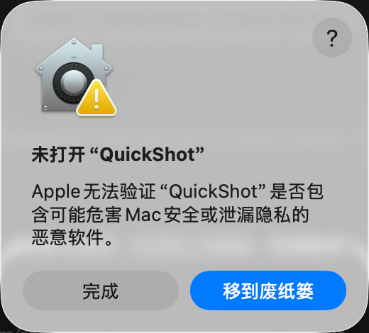
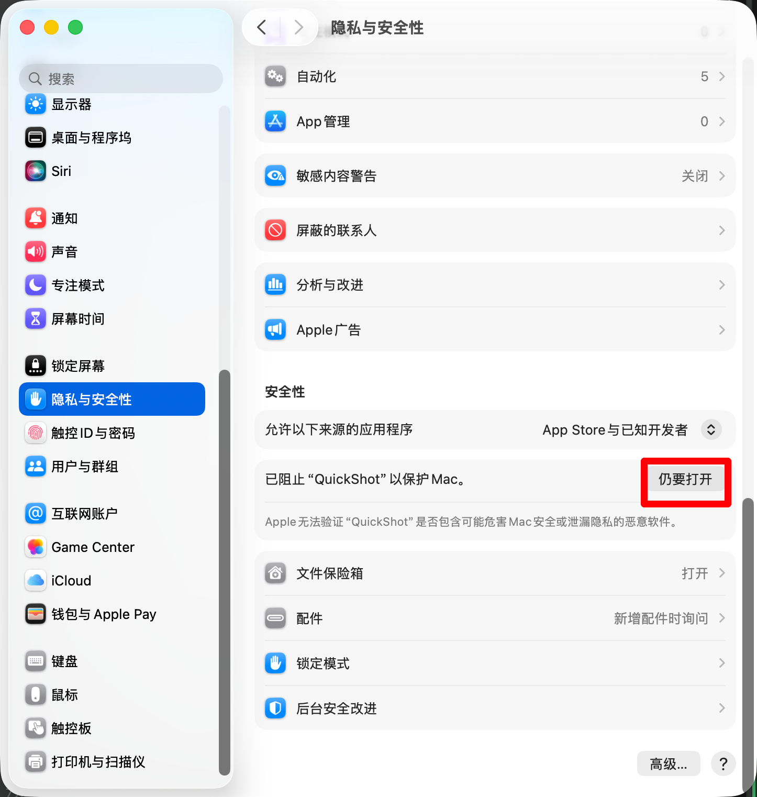
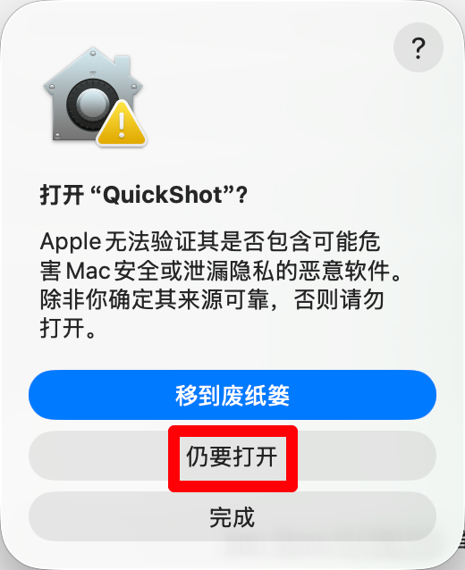
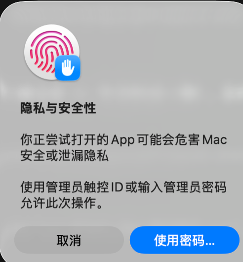
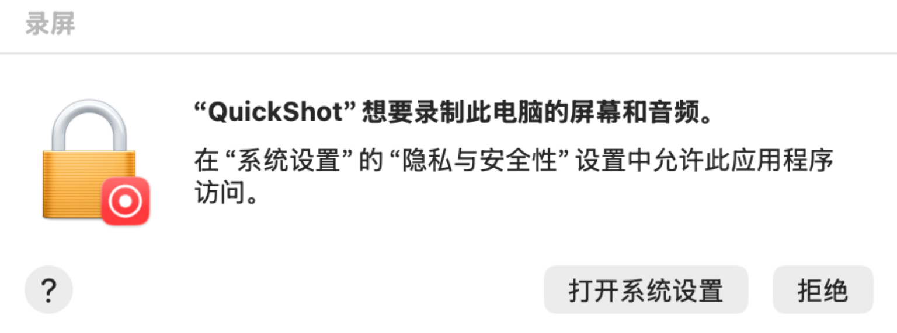
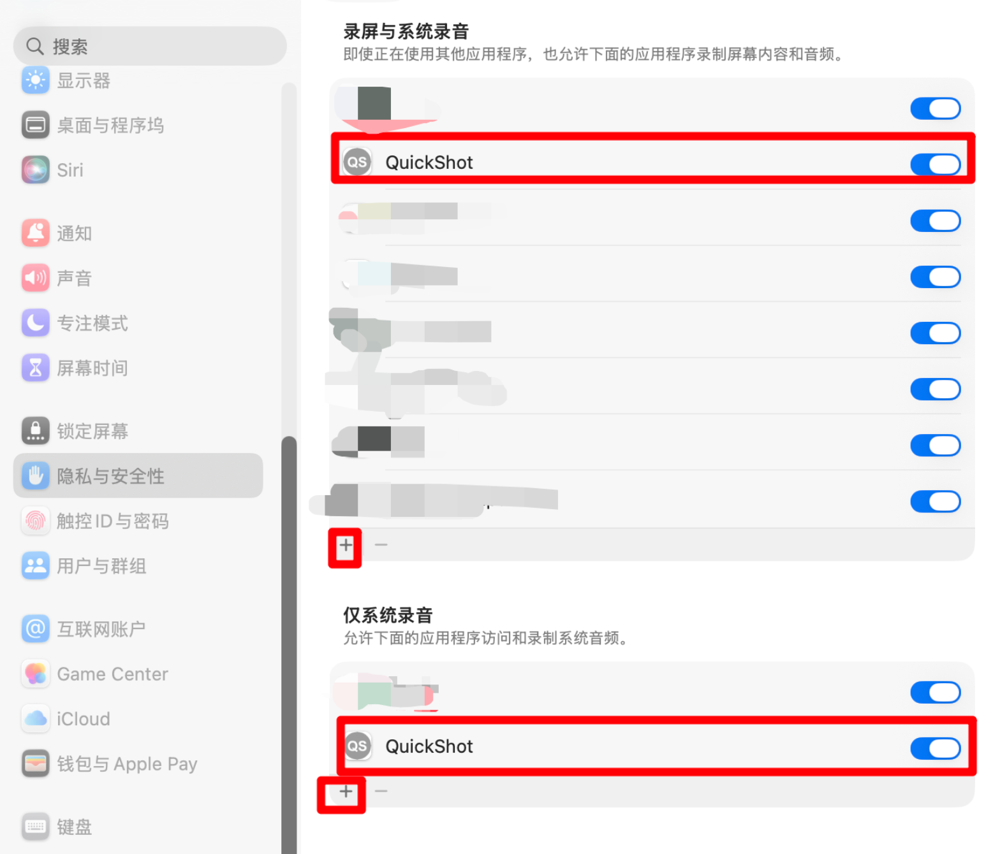

# QuickShot Screen Capture Tool

QuickShot is a lightweight, powerful screen capture and recording tool developed with **Qt 6**. It runs on **Windows** and **macOS** (Linux support is still incomplete — recording does not yet produce video files), designed to provide an efficient and smooth screenshot experience.

Current version: **v0.1.5** — download the latest release from [GitHub Releases](https://github.com/ChiangyangNPU/quick-shot/releases).

  

## 📚 Table of Contents

* [macOS First Open: Un-notarized App](#macos-first-open)
* [macOS First Launch: Screen Recording Permissions](#macos-permissions)
* [Key Features](#features)
* [Installation & Deployment](#installation)
* [Technical Features](#technical)
* [Development Environment](#dev-env)
* [More Documentation](#docs)
* [License](#license)
* [Third-Party Resources](#third-party)

<a id="macos-first-open"></a>

## ⚠️ macOS First Open: Manually Allow the Un-notarized App

QuickShot is **not notarized by Apple** yet. After installing from a DMG downloaded in a browser, the first launch is blocked by macOS: *"Apple could not verify 'QuickShot' is free of malware that may harm your Mac or compromise your privacy."* Follow these 4 steps once — afterwards it opens normally:



1. Click **Done** in the dialog — do **not** click **Move to Trash** (that deletes the app).
2. Open **System Settings → Privacy & Security**, find **"QuickShot" was blocked to protect your Mac** under **Security**, then click **Open Anyway**:



3. Click **Open Anyway** once more in the confirmation dialog:



4. Authenticate with **Touch ID**, or click **Use Password…** and enter your admin password, to allow this action:



macOS remembers your choice, so later launches open normally.

> On some macOS versions, right-clicking (Control-clicking) QuickShot.app in Finder → **Open** also leads into the confirmation flow above; if nothing happens, use the System Settings path.
> Removing this prompt entirely requires an Apple Developer certificate and notarization, which this project has not set up yet.
> DMGs built locally (`deploy/mac/deploy_mac.sh`) carry no browser quarantine flag and are not blocked by Gatekeeper.

<a id="macos-permissions"></a>

## ⚠️ macOS First Launch: Screen Recording & System Audio Permissions

> **Grant permissions before capturing.** On first launch, complete the steps below before taking a screenshot or recording. If you trigger a screenshot/recording first, macOS shows the permission dialog, but granting access afterwards may still not take effect — quit and relaunch QuickShot if that happens.

The first time you open QuickShot to take a **screenshot or record the screen**, macOS shows a dialog: **"QuickShot" wants to record this computer's screen and audio** — this is the system's security requirement for accessing screen content. Allow it so that screenshots, recording, OCR and other features work properly:



1. Click **Open System Settings** in the dialog (or go manually to: System Settings → Privacy & Security).
2. In the **Screen & System Audio Recording** list: if QuickShot is already listed, simply turn on its toggle; if not, click the **＋** button at the bottom-left of the list, select QuickShot.app to add it, then turn the toggle on.
3. In the **System Audio Only** list below, also make sure QuickShot's toggle is on (required for capturing system audio; add it via **＋** if missing).



4. To record **microphone** audio, also enable QuickShot under Privacy & Security → Microphone.
5. **Quit and relaunch QuickShot** for the permission to take effect.

<a id="features"></a>

## ✨ Key Features

### 1. Smart Capture

* **Global Shortcuts**: Defaults are `Alt + Q` capture, `Alt + S` record, `Alt + H` history, `Alt + P` pin clipboard, `Alt + Shift + F` fullscreen capture, `Alt + Shift + W` active window capture, `Alt + Shift + S` record pause/resume, `Alt + Shift + Q` record stop, `Alt + Shift + P` toggle all pins — all customizable in Settings.
* **Auto Window Detection**: Automatically detects and highlights window areas when hovering over software windows; click to select quickly.
* **Display/Fullscreen Switching**: Supports rectangular area, window, display, and desktop capture modes; use the mouse wheel to quickly switch snapping levels.
* **Free Rectangular Selection**: Drag to create rectangular screenshot areas of any size.
* **Scroll Capture (Long Screenshot)**: After selecting an area, press `V` for vertical or `H` for horizontal, or click the toolbar "Scroll Capture" button. Scroll the page to auto-stitch; `Enter` finishes and `Esc` cancels. The selection border stays visible throughout and never appears in the stitched image, and the hint bar toggles direction with one click; fixed footers are detected and excluded, and the result opens in a pinned window for copy/save/annotation/translation.
* **Smart Right-Click Interaction**: With no selection, right-click snaps to the window under the mouse (or the full screen on desktop background); with a selection active, right-click cancels the screenshot; while drawing, right-click cancels the current drawing to prevent accidental touches.

### 2. Powerful Annotation Tools

Once a screenshot area is selected, the bottom toolbar provides rich editing functions with **secondary menu** customization:

* **🔲 Shape Tools**: Rectangle, ellipse, triangle, line, arrow; 12-color preset palette (`Tab` cycles through it); every shape tool supports solid/dashed switching, with the line-style preference remembered per tool across restarts.
* **✏️ Pen Tool**: Freehand drawing and writing, with stroke width adjustment and color selection.
* **📝 Text Tool**: Input text anywhere on the screenshot, with real-time font size adjustment, color changing and drag positioning.
* **▒ ▓ Mosaic Tool**: Pixelate sensitive information (like accounts, passwords).
* **🧹 Eraser Tool**: Click or drag over annotations to delete them.
* **🖱️ Drag to Move**: Hover the mouse over the most recent annotation (except mosaic/eraser) to drag and reposition it; movement is constrained within the selection area, with undo/redo support.
* **Undo/Redo**: `Ctrl+Z` to undo and `Ctrl+Y` to redo; move operations are undone before annotation creation.
* **📐 Annotation Constraints**: When drawing rectangle/ellipse/arrow/line, hold `Shift` for proportional constraint, hold `Alt` to draw symmetrically from the center, and combine both; constraints are clamped within the selection.

### 3. Flexible Area Adjustment

* **Fine-tuning**: Drag any of the 8 edges or corners to resize the screenshot area.
* **Move Selection**: Click and drag inside the selection area to move the entire screenshot area.
* **Locked Annotation Mode**: Selecting an annotation tool locks the selection area for focused annotation.

### 4. 📝 OCR Text Recognition

* **One-click Recognition**: Click the "Text Recognition" button on the toolbar to recognize text in the screenshot area.
* **Multi-language Support**: Supports Chinese + English, English, Japanese, Korean, and multilingual mixed text.
* **GPU Acceleration**: Enable GPU acceleration in Settings to improve recognition speed.
* **Result Display**: Results are shown in a dialog with one-click copy-all, and support dragging to move and resizing from edges/corners.
* **Multiple Entry Points**: OCR is also available during screen recording and from the pin window right-click menu.
* **Background Execution**: Recognition runs asynchronously in a background thread without blocking the UI.

### 5. 🌐 Text Translation

QuickShot provides two translation forms based on OCR results, translating recognized text into the target language with support for 4 translation engines.

**Form 1: In-dialog Comparison Translation** — click "Translate" at the bottom of the OCR result dialog to switch between Original / Translation / Side-by-side views; whole-segment translation means fewer requests and lower quota consumption.

**Form 2: Translation Result Window (Side-by-Side Layout)**

* **Four entry points**: screenshot toolbar, recording toolbar, pin window right-click menu, and clothesline card hover-preview right-click menu.
* **Split window**: the left pane shows the screenshot scaled proportionally, with a draggable splitter to adjust both pane widths; the right pane is a scrollable, selectable translation area supporting Original only / Translation only / Side-by-side (Translation by default).
* **Window controls**: drag by the title bar, double-click to close, resize from the bottom-right grip, `Esc` to close; follows the app's light/dark theme.
* **Copy & save**: the bottom action bar offers "Copy All" and "Save as Image"; the right-click menu offers view modes, copy original, copy translation, save as image, and close.
* **Batch Translation**: Translates segment by segment in order; single-segment failures fall back to original text without interrupting the overall flow.

| Engine          | Type                      | Description                                                                        |
| --------------- | ------------------------- | ---------------------------------------------------------------------------------- |
| MyMemory        | Default, no registration  | Direct access from China, 5000 words/day without email, 50000 words/day with email |
| Baidu Translate | User-provided AppId + Key | Stable in China, 2 million characters/month free                                   |
| DeepL           | User-provided Key         | Highest translation quality                                                        |
| LibreTranslate  | User-provided URL         | Can be self-hosted for fully offline use                                           |

> **Privacy Protection**: A dialog appears on first translation use explaining that text will be sent to third-party services, with a "Don't ask again" option. All Keys / URLs are entered by the user in Settings; the software does not embed any credentials, and API Keys are stored encrypted (Windows DPAPI / macOS Keychain). See [Translation Feature Technical Doc](docs/translation-design.md) for details.

### 6. 📌 Pin to Desktop

* **Pin**: Click the "Pin" button on the toolbar to pin the current screenshot (including annotations) to the desktop; it stays on top by default, can be dragged to move and resized from its edges (no quality loss on High DPI), and closes on double-click.
* **Wheel Zoom**: Supports mouse wheel zoom, with annotations and mosaic strokes scaling synchronously.
* **Context Menu**: Copy → Annotate → OCR → Translate → Save (close via double-click or `Esc`).
* **Annotation Mode**: Enter from the right-click menu with 8 tools (rectangle/ellipse/arrow/pen/line/text/mosaic/eraser, switch with number keys 1-8), supporting Shift/Alt constraints and undo/redo.
* **Pin Shortcuts**: `Ctrl+C` copy, `Ctrl+S` save, `Ctrl+Z`/`Ctrl+Y` undo/redo (`Ctrl+Shift+Z` as a redo alias), arrow keys move window (`Ctrl+Arrow` 10px fast move), `Delete`/`Backspace` clear all annotations, `F5` re-grab the screen, `Esc` exit annotation mode or close window.
* **Alt+P Clipboard History Pagination**: The first press shows the latest screenshot centered on the current mouse screen; subsequent presses cycle older screenshots in reverse chronological order (each window offset by (24,24) and clamped to screen bounds), wrapping back to the newest after the oldest.
* **Toggle All Pins**: `Alt + Shift + P` hides/shows all pinned windows.

### 7. 📹 Screen Recording

* **Global Shortcut**: Default is `Alt + S` to start recording (customizable in Settings).
* **Area/Window Recording**: Record any rectangular area or a specific window directly.
* **Audio Recording**: System audio and microphone are independently toggleable and can be recorded simultaneously.
* **Recording Control**: Start, pause, resume and stop; canceling a recording deletes the generated video file automatically.
* **Real-time Annotation**: All annotation tools (arrow/rectangle/ellipse/triangle/line/pen/text/mosaic/eraser) are available during recording; annotations never double-layer on the final video, and the drag process itself is recorded.
* **Recording Format**: The control bar provides an MP4 / GIF dropdown that persists globally; selecting GIF automatically unchecks and disables the audio options.
* **GIF Recording**: Both toolbars offer a one-click GIF entry (10 fps by default, no audio track) using a built-in pure-Qt encoder, available on Windows / Linux; not yet supported on macOS, where the entry is hidden automatically.
* **Snapshot**: Capture the current frame to the clipboard without stopping the recording; the snapshot is also written to history for `Alt+P` pagination.
* **Original Resolution**: The output resolution equals the physical pixel size of the selected region, with no scaling loss.
* **Others**: Customizable save directory and real-time recording duration display.
* **macOS Support**: Built on ScreenCaptureKit, requires macOS 13+ (Ventura), supports Retina high-resolution recording.

### 8. 📋 History Feature

* **Global Shortcut**: Default is `Alt + H` to open the history window (customizable in Settings).
* **Screenshot History**: Automatically records all screenshots (including saved and copied ones) with thumbnails for quick browsing.
* **Clipboard History**: Automatically records copied/cut text, including source application info.
* **Categorized View & Search**: View by "All / Screenshots / Texts" and search by keyword.
* **Multi-select & Batch Operations**: Drag-box selection, `Ctrl+click` to append, `Shift+click` for range selection, and batch deletion; button states follow the selection count and type.
* **Actions**: Copy text/screenshot to clipboard, save screenshot to file, delete single/batch records, clear all history, plus a right-click menu with shortcuts.
* **Auto Cleanup**: Cleans expired records (default 7 days retention) and excess records (default max 1000 items) on startup; manual cleanup also supported.
* **Real-time Refresh**: New records appear automatically while the history window is open.
* **Local Storage**: All history is stored only in a local SQLite database, never uploaded to any server.

### 9. ⚙️ Settings Center

Right-click the system tray icon to access "Settings". **Seven tabs in order: General → Shortcuts → Style → Translate → History → Desktop Pet → About**.

* **General**: UI language (Simplified Chinese / English / Japanese / Korean / Traditional Chinese HK & TW), auto-start on boot, screenshot and recording save directories, log and config file management, OCR recognition language, GPU acceleration.
* **Shortcuts**: 9 customizable global hotkeys, with annotation tool, annotation operation and pin shortcuts grouped and displayed; changes take effect immediately.
* **Style**: One-click light/dark theme switching (the dark theme is HUD-style and applies to the whole app UI); customize 20+ UI colors, button display mode (text/icon), and sub-toolbar/control-bar colors.
* **Translate**: Select the translation engine, target language (English by default), fill in the engine's API Key / URL, and toggle the translation feature and first-use privacy prompt.
* **History**: Toggle screenshot/clipboard history, set retention (7/30/90/180/365 days) and max record count (500/1000/2000/5000), clean expired records, clear all history, view storage usage.
* **Desktop Pet**: Enable the pet, built-in and custom looks, accessories, clothesline trigger, todo reminder, pomodoro and doze durations, system status monitoring, festival surprise and birthday, reset pet position.
* **About**: Version information and the GitHub repository link.

### 10. 🐾 Desktop Pet

* **Appearance**: 16 code-drawn styles (classic: cat/panda/penguin/frog; 12 zodiac animals) plus 2 image-based special styles (Whale Girl / Whale Girl 2), with 7 accessories; local PNG/JPG/WebP/GIF files can be imported as a custom look. All settings persist and are restored on relaunch.
* **Interaction**: A frameless, transparent, always-on-top window resident on the desktop (draggable); blinks randomly while idle, opens its mouth and bounces while chewing, bounces when head-patted by double-click, dozes off after a long idle period and wakes on any interaction.
* **Feeding Animation**: After screenshot copy/pin/snapshot, the screenshot flies from its original position into the pet's mouth; copied text flies in as a card from the cursor position.
* **Todo List & Pomodoro**: Right-click the pet to expand the todo-list bubble (persisted locally); unfinished/overdue todos show a red-dot badge above its head; the pomodoro pops work/break reminder cards on schedule.
* **System Status**: Optionally monitors CPU/memory usage and battery level, and hints through the pet when something is off.
* **Festival Surprise**: Automatically wears themed hats on Christmas/Halloween/New Year, and celebrates your configured birthday.
* **Clothesline (Quick History Panel)**: Spans the full width of the primary screen and hangs the latest 12 history cards with swaying and staggered entrance animations, refreshing live. Hover for an enlarged preview (images support 0.2–10x wheel zoom), click to copy, right-click for Copy / Annotate / OCR / Translate; both the trigger (click the pet / top-edge hot zone / both) and the close methods are configurable.

<a id="installation"></a>

## 📦 Installation & Deployment

### Developer Build

1. Ensure Qt 6.10.2 (the development version; 6.10 or newer recommended) and CMake 3.20+ are installed.
2. Clone the project and build:

   ```bash
   mkdir build && cd build
   cmake ..
   cmake --build .
   ```

**Build options & dependencies**:

* **ONNX Runtime**: OCR inference library (1.26.0). On Windows, if not detected at configure time, CMake automatically downloads and extracts it to `third_party/onnxruntime`; you can also point to an existing installation via the `ONNXRUNTIME_ROOT` environment variable (or CMake variable of the same name), or pre-place it there.
* `ENABLE_OCR_GPU_ACCELERATION`: Whether to compile OCR GPU acceleration support (CoreML/DirectML), default `ON`.
* `QUICKSHOT_BUILD_TESTS`: Whether to build unit tests, default `ON`.

**Running Tests**: the `tests/` directory contains 14 Qt Test unit tests. After building with the default `QUICKSHOT_BUILD_TESTS=ON`, run `ctest` in the build directory to execute them all.

**Version Management**: the version is managed centrally by [CMakeLists.txt](CMakeLists.txt) via `project(QuickShot VERSION x.y.z)` and injected into the sources through the `QUICKSHOT_VERSION` macro. After changing the version, use **Reset Cache and Reload CMake Project** in CLion.

> **Windows environment setup & path configuration** (Qt / MinGW / CMake / ONNX Runtime paths, CLion toolchain, common issues): see the [Windows Build Guide](docs/build-windows.md).

### Quick Packaging

Automated packaging scripts are provided, so there is no need to copy DLLs manually; the scripts read the version number from CMakeLists.txt automatically.

**Windows**: run the PowerShell script in the `deploy/win/` directory.

```powershell
.\deploy.ps1      # Package both Debug and Release (default)
.\deploy.ps1 -r   # Package Release only
.\deploy.ps1 -d   # Package Debug only
```

The script generates a `QuickShot-Release-v{version}-Windows-x64` folder under `deploy/win/` (containing the directly runnable `QuickShot.exe` and all its dependencies) plus a corresponding zip package.

**macOS**: run the Shell script in the `deploy/mac/` directory.

```bash
./deploy_mac.sh                           # Build both Debug and Release (default)
./deploy_mac.sh -r                        # Build Release only
./deploy_mac.sh -d                        # Build Debug only
./deploy_mac.sh -r --no-gpu-acceleration  # Disable CoreML, CPU-only inference
```

The script generates `QuickShot-Release-v{version}.dmg` under `deploy/mac/` (including Qt dependencies, ONNX Runtime, language files, automatically code-signed). See the [Mac Deployment Guide](deploy/mac/README_DEPLOY_MAC.md) for details.

<a id="technical"></a>

## 🛠️ Technical Features

* **Cross-platform**: Windows uses Media Foundation + WASAPI and macOS uses ScreenCaptureKit + AVAssetWriter for recording; Linux currently has X11 frame capture and GIF encoding only.
* **High DPI & Multi-Monitor**: Manual DPI adaptation (`pt`/`em` units, global stylesheet reload on DPI change) keeps screenshots and pins pixel-perfect at 1:1; Windows/Linux use the virtual-desktop global coordinate system for cross-screen capture and recording, while macOS stays Sidecar/AirPlay compatible.
* **Internationalization**: 6 built-in languages (Simplified Chinese, English, Traditional Chinese HK/TW, Japanese, Korean) switchable at runtime.
* **OCR & Translation**: ONNX Runtime + PP-OCRv4 models with GPU acceleration; four translation engines (MyMemory / Baidu / DeepL / LibreTranslate).
* **Performance**: Lazy initialization of OCR models and translation engines, background-thread capture and OCR, and reused recording frame buffers.
* **Auto Update**: Multi-channel fallback (Gitee / GitHub / official site, ordered by region), SHA256 verification and rollback-capable updates.
* **Configuration & Logging**: QSettings-based persistence and leveled logs written to the `logs/` folder under the installation directory.

<a id="dev-env"></a>

## 🚀 Development Environment

* **Language**: C++ 17
* **Framework**: Qt 6.10.2
* **Build System**: CMake
* **Compiler**: MinGW 64-bit (Windows) / Clang (macOS)
* **OCR**: ONNX Runtime

<a id="docs"></a>

## 📚 More Documentation

* [Architecture](docs/architecture.md): module breakdown, overall design and key design decisions.
* [Annotation System](docs/annotation.md): annotation tools, interaction, shortcuts and extension guide.
* [OCR Feature](docs/ocr.md): OCR engine implementation and configuration.
* [History Feature](docs/history-feature.md): history and clothesline quick-panel design.
* [Desktop Pet Companion](docs/pet-companion-plan.md): todos / pomodoro / dozing / system status / festival surprises.
* [Translation Feature](docs/translation-design.md): translation engine abstraction and batch-translation flow.
* [Shortcuts](docs/shortcuts.md): global hotkeys and annotation/pin shortcuts.
* [Windows Recording](docs/recording-windows.md): Windows recording implementation details.
* [macOS Recording](docs/recording-macos.md): macOS ScreenCaptureKit recording implementation.
* [Windows Build Guide](docs/build-windows.md): Windows environment setup and common issues.
* [Release Process](docs/release-publish.md): publishing releases to GitHub / Gitee.
* [Multi-Remote Sync](docs/git-multi-remote.md): managing GitHub / Gitee remotes.

<a id="license"></a>

## 📄 License

This project uses a **dual licensing** model:

### Open Source: GPLv3

The project is released under the **GNU General Public License v3.0**, with copyright held by the original author **chiangyang**. You are free to use, modify and distribute it as long as you comply with GPLv3:

* ✅ Personal use, learning, research, and internal enterprise use
* ✅ Modify and distribute (full corresponding source must be released under GPLv3 as well)
* ❌ Distribute the project or derivative works in closed-source form

### Commercial License

If you want to integrate this project into a closed-source product, redistribute a modified version without publishing sources, or otherwise be exempt from GPLv3's source-disclosure obligations, contact the author for a commercial license. See the [Commercial License Notice](COMMERCIAL-LICENSE.md) for details.

> Note: GPLv3 is compatible with this project's dependencies (Qt 6 open-source edition LGPLv3, ONNX Runtime MIT, PaddleOCR Apache-2.0).

See the [LICENSE](LICENSE) file for the full terms.

<a id="third-party"></a>

## 📦 Third-Party Resources

This project uses the following open-source resources:

### OCR Algorithm and Models

* **OCR Core Algorithm**: Ported from the [PaddleOCR](https://github.com/PaddlePaddle/PaddleOCR) open-source project
  * Implementation: DB detection post-processing, image preprocessing, CTC recognition decoding
  * License: [Apache License 2.0](https://www.apache.org/licenses/LICENSE-2.0)
  * Usage: Algorithm logic ported to pure C++/Qt implementation, no OpenCV dependency
* **PP-OCRv4 Models**: Pre-trained models based on the PaddleOCR open-source project
  * License: [Apache License 2.0](https://www.apache.org/licenses/LICENSE-2.0)
  * Usage: Pre-trained ONNX model weight files are used

### Inference Engine

* **ONNX Runtime**: Microsoft's open-source machine learning inference engine
  * License: [MIT License](https://opensource.org/licenses/MIT)
  * Project: <https://github.com/microsoft/onnxruntime>

### Qt Framework

* **Qt 6**: Cross-platform C++ application development framework
  * License: LGPL 3.0 / GPL 3.0 (open source edition)
  * Project: <https://www.qt.io/>

Thanks to the above open-source projects for their contributions!
