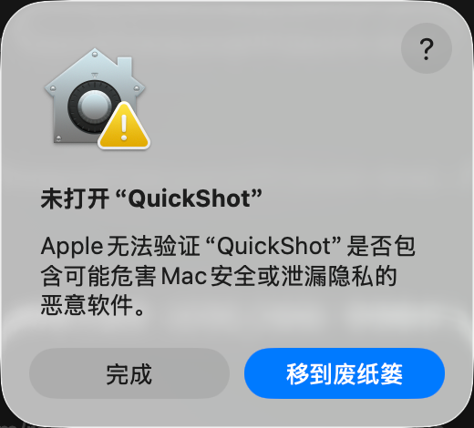
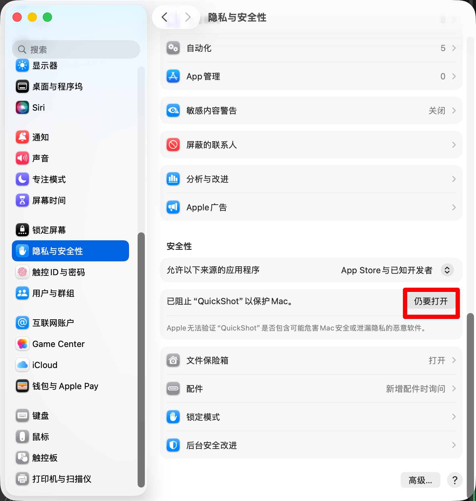
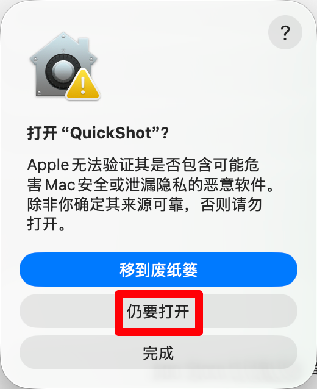
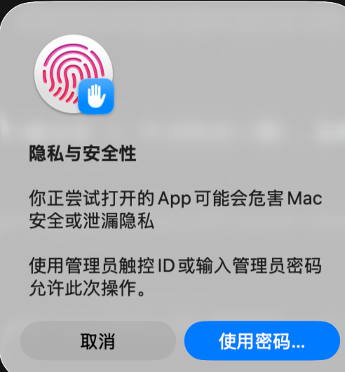
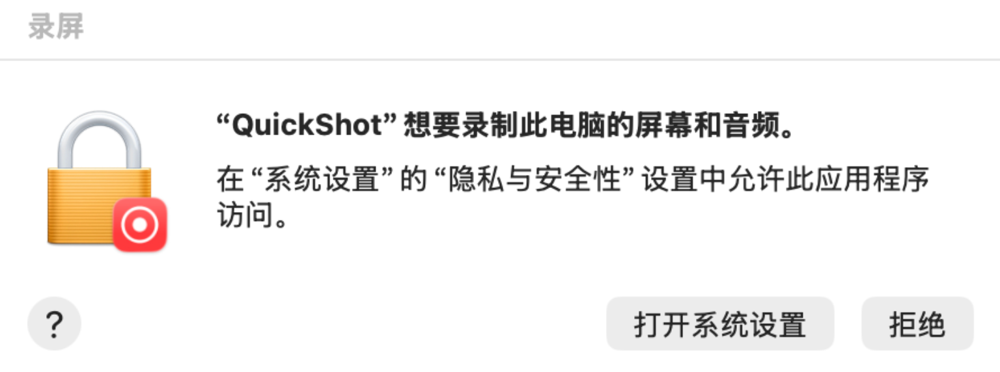
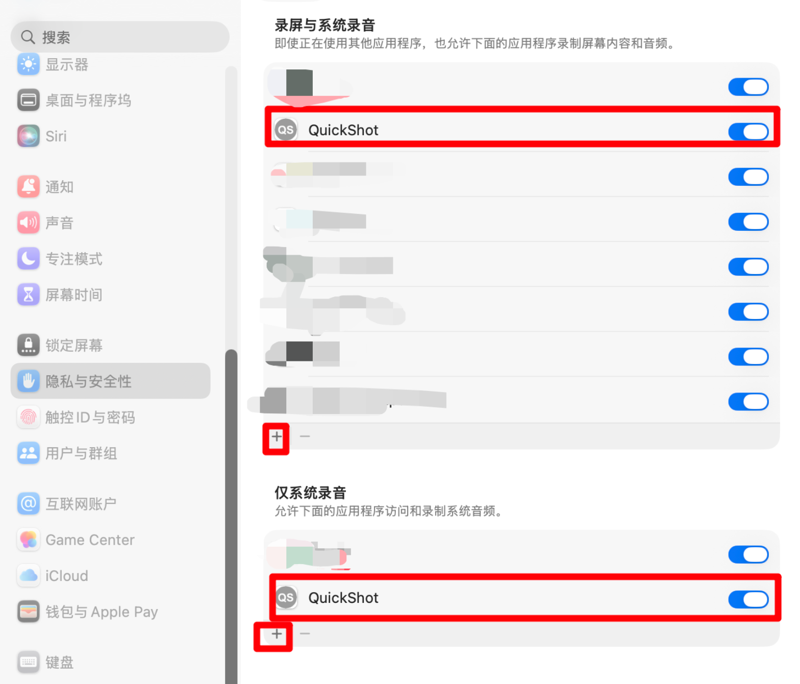

# QuickShot 截图工具

QuickShot 是一款轻量级、功能强大的屏幕截图与录制工具，基于 **Qt 6** 开发，支持 **Windows** 与 **macOS** 双平台（Linux 支持尚不完整，录屏暂不产出视频文件），旨在提供高效、流畅的截图体验。

当前版本 **v0.1.2**，可从 [GitHub Releases](https://github.com/ChiangyangNPU/quick-shot/releases) 下载最新版本。

  

## ⚠️ macOS 首次打开：未公证应用需手动放行

QuickShot 目前**未做 Apple 公证**，从网页（浏览器）下载的 DMG 安装后，首次双击打开会被 macOS 拦下，提示「Apple 无法验证"QuickShot"是否包含可能危害 Mac 安全或泄漏隐私的恶意软件」。按下面 4 步放行一次即可，之后都能正常打开：



1. 在弹窗里点「**完成**」——**不要**点「移到废纸篓」，那会把应用删掉。
2. 打开「**系统设置 → 隐私与安全性**」，在「**安全性**」一栏找到「已阻止"QuickShot"以保护 Mac」，点右侧的「**仍要打开**」：



3. 在确认弹窗里再点一次「**仍要打开**」：



4. 按提示用**触控 ID** 验证，或点「**使用密码…**」输入管理员密码，允许此次操作：



系统会记住这次选择，之后双击即可正常打开。

> 部分 macOS 版本上，在 Finder 里**右键（或 Control + 点击）QuickShot.app →「打开」**也会进入上面的确认流程；若没有反应，按上面的系统设置路径操作。
> 想彻底消除该提示，需要 Apple Developer 证书并对应用做公证（本项目暂未配置）。
> 本地自行打包（`deploy/mac/deploy_mac.sh`）的 DMG 不带浏览器下载标记（quarantine），不会被 Gatekeeper 拦截。

## ⚠️ macOS 首次启动：录屏与系统录音授权

首次打开 QuickShot 进行**截图或录屏**时，macOS 会弹出 **""QuickShot"想要录制此电脑的屏幕和音频"** 系统弹窗——这是系统对屏幕内容访问的安全要求，允许后截图、录屏、OCR 等功能才可正常使用：



1. 在弹窗中点击「**打开系统设置**」（也可手动前往：系统设置 → 隐私与安全性）。
2. 在「**录屏与系统录音**」列表中：若 QuickShot 已在列表中，打开其开关即可；若没有，点击列表左下角 **＋** 按钮，选择 QuickShot.app 添加，并打开开关。
3. 在下方「**仅系统录音**」列表中，同样确认 QuickShot 的开关已打开（录制系统声音需要，没有也按 ＋ 添加）。



4. 若需录制**麦克风**声音，另在「隐私与安全性」→「**麦克风**」中勾选 QuickShot。
5. 授权后**退出并重新打开 QuickShot** 才会生效。

## ✨ 核心功能

### 1. 智能截图模式
*   **全局快捷键**: 默认 `Alt + Q` 截图、`Alt + S` 录屏、`Alt + H` 历史记录、`Alt + P` 贴图剪贴板（支持历史截图循环分页）、`Alt + Shift + F` 全屏截图、`Alt + Shift + W` 活动窗口截图、`Alt + Shift + S` 录屏暂停/恢复、`Alt + Shift + Q` 录屏停止、`Alt + Shift + P` 隐藏/显示所有贴图（均通过 ShortcutManager 集中管理，可在设置中修改）。9 个全局热键均由数据表驱动，新增一个全局热键只需 2 处修改（数据表条目与分发分支）。
*   **智能窗口吸附**: 鼠标悬停在软件窗口上时，自动智能识别并高亮窗口区域，点击即可快速选取。
*   **显示器/全屏切换**: 支持矩形区域、窗口、显示器、桌面四种截图范围，鼠标滚轮可快速切换吸附层级。
*   **自由矩形选区**: 支持鼠标拖拽，创建任意大小的矩形截图区域。
*   **长截图（滚动截图）**: 选区完成后按 `V` 垂直或 `H` 水平开始，也可点击工具栏「长截图」按钮（左键垂直，右键菜单可选水平）；滚动页面自动拼接，`Enter` 完成、`Esc` 取消。自动识别并排除固定页脚，结果以贴图窗口展示，可继续复制/保存/标注/翻译。
*   **智能右键交互**:
    *   **未选区时**: 右键点击自动吸附当前鼠标下的窗口；若鼠标在桌面背景，自动全屏。
    *   **已选区时**: 右键点击取消当前截图（退出）。
    *   **正在绘图时**: 右键点击取消当前的绘制操作，防止误触。

### 2. 强大的标注工具
截图选定后，底部工具栏提供丰富的编辑功能，支持**二级菜单**自定义：
*   **🔲 图形工具**:
    *   **矩形**: 快速框选重点。
    *   **椭圆**: 圈选重要区域。
    *   **三角形**: 标记重要区域，适合指向性标注。
    *   **直线**: 连接两点，绘制直线标注。
    *   **箭头**: 快速指向重点内容（锐角三角形箭头，尺寸适中）。
    *   **颜色选择**: 12 色预设面板（红/绿/蓝/黄/青/品红/黑/白/灰/暗红/暗绿/暗蓝），`Tab` 键按面板顺序循环切换。
    *   **实线/虚线切换**: 矩形、椭圆、三角形、箭头、直线、画笔均支持一键切换实线/虚线，各工具线型偏好独立记忆、重启后保持（虚线间隔随线宽自动缩放，箭头头部保持实心）。
*   **✏️ 画笔工具**:
    *   自由书写和绘制线条。
    *   支持**粗细调节**和颜色选择。
*   **📝 文本工具**:
    *   支持在截图任意位置输入文字。
    *   支持**实时字号调整**和**颜色更换**。
    *   文本框支持拖动调整位置。
*   **▒ ▓ 马赛克工具**: 对敏感信息（如账号、密码）进行像素化模糊处理。
*   **🧹 橡皮擦工具**: 点选或划过标注即可将其删除。
*   **🖱️ 拖动移动**: 鼠标悬停在最近一个标注上（马赛克/橡皮擦除外），光标变为可拖动状态，按住即可整体拖动标注到新位置，移动范围限制在选区内，支持撤销/重做。
*   **撤销/重做**: 支持快捷键 Ctrl+Z 撤销、Ctrl+Y 重做，可清除所有标注。撤销优先级：先撤销移动操作，再撤销标注创建。
*   **📐 标注约束**: 绘制矩形/椭圆/箭头/直线时按住 `Shift` 等比约束（正方形/圆/45° 直线），按住 `Alt` 以起点为中心向两侧对称绘制（中心约束），`Shift+Alt` 可组合使用。约束范围自动限制在选区内。
*   **🎯 控制点光标样式自适应**: 根据控制点位置设置不同光标，直观指示调节方向：矩形 TL/BR ↘（SizeFDiagCursor）、TR/BL ↙（SizeBDiagCursor）、上下边中点 ↕（SizeVerCursor）、左右边中点 ↔（SizeHorCursor）；椭圆左/右 ↔、上/下 ↕；直线/箭头/三角形控制点 ✥（SizeAllCursor）。绘制按下过程中光标保持不变。
*   **▒ 全局马赛克算法 + 橡皮擦联动画笔粗细**: 马赛克采用「全局预处理 + QRegion 裁剪」算法（整张背景一次缩放下采样/放大采样，笔迹矩形合并裁剪区一次性绘制），消除逐块错位跳色；马赛克涂抹半径 = 橡皮擦半径 = 画笔粗细 × 2，三者通过 `m_currentPenWidth` 联动。
*   **🔁 标注交互统一 AnnotationInteractionHandler**: 截屏、录屏、贴图三处标注交互逻辑通过 AnnotationInteractionHandler + Host 回调策略共享同一套实现（鼠标事件优先级统一、控制点光标、录屏 overlay 同步、Shift/Alt 约束一致），新增标注功能只需修改一处，三处同步生效。

### 3. 灵活的区域调整
*   **选区微调**: 截图区域的 8 个边缘和角点均可拖动，精细调整截图范围。
*   **整体移动**: 鼠标按住选区内部，可自由拖动整个截图选区的位置。
*   **锁定标注模式**: 选择标注工具后选区锁定，专注于绘制标注。

### 4. 📝 OCR 文字识别
*   **一键识别**: 点击工具栏的「文字识别」按钮，即可对截图区域进行文字识别。
*   **多语言支持**: 支持识别中英文、英文、日文、韩文和多语言混合文本。
*   **GPU 加速**: 在设置中可启用 GPU 加速，提升识别速度。
*   **结果展示**: 识别结果以弹窗形式展示，支持一键复制全部文本到剪贴板，支持鼠标拖动移动窗口和边缘/角落调整大小。
*   **录屏集成**: 在录屏模式下同样支持 OCR 文字识别功能。
*   **贴图识别**: 在贴图窗口右键菜单中可直接对贴图进行 OCR 识别。
*   **自动资源管理**: 识别在后台线程异步执行；所有入口识别完成后自动释放模型，下次识别时重新初始化。

### 5. 🌐 文字翻译功能
QuickShot 提供两种翻译形式，基于 OCR 识别结果将文字翻译为目标语言，支持 4 种翻译引擎：

#### 形式一：OCR 结果弹窗内对照翻译
*   在 OCR 识别结果弹窗底部点击「翻译」按钮，弹窗内可切换原文 / 译文 / 对照三态视图。
*   采用整段翻译，请求次数少、额度消耗低。

#### 形式二：译文叠加显示（位置感知）
*   **四处入口**：截图工具栏翻译按钮、录屏工具栏翻译按钮、贴图窗口右键「翻译」项、晾衣绳卡片悬停预览右键「翻译」项（图片走 OCR→译文叠加；文本直接调翻译服务弹出译文）。
*   **位置叠加**：译文按 OCR 识别到的文字位置叠加回原图，保留原版式。
*   **独立窗口**：弹出独立的 `TranslateOverlayWindow` 窗口，支持：
    *   视图模式切换：仅原文 / 仅译文 / 对照（原文下方追加译文）。
    *   窗口拖动、右下角缩放、滚轮放大缩小、ESC 关闭、双击关闭。
    *   翻译成功显示 Overlay 后自动退出截图框（类似贴图完成后销毁截图框），PinWindow 翻译后保持贴图窗口。
    *   右键菜单：视图模式、文字选择模式、复制原文、复制译文、另存为图片、关闭。
    *   **文字选择模式**：勾选「文字选择模式」后，可自由跨行跨段鼠标拖选译文；选字模式内右键保留 Copy/Select All（本地化），追加「文字选择模式」勾选项（取消即退出）和「取消」（退出并关闭 Overlay）；Ctrl+C 复制，ESC 退出选择模式。
*   **批量翻译**：按 OCR 识别段逐段顺序翻译，单段失败回退原文不中断整体流程。

#### 翻译引擎
| 引擎 | 类型 | 说明 |
|---|---|---|
| MyMemory | 默认，免注册 | 国内可直连，无 email 5000 词/天，填 email 提升至 50000 词/天 |
| 百度翻译 | 用户自填 AppId + Key | 国内稳定，每月免费 200 万字符 |
| DeepL | 用户自填 Key | 翻译质量最高 |
| LibreTranslate | 用户自填 URL | 可自托管实现完全离线 |

> **隐私保护**：首次使用翻译时弹窗说明文本将发送到第三方服务，可勾选「不再提示」。所有 Key / URL 由用户在设置页填写，软件不预置任何凭证，API Key 经 SecretStore 加密存储（Windows DPAPI / macOS Keychain）。详见 [翻译功能技术文档](docs/translation-design.md)。

### 6. 📌 贴图 (Pin) 功能
*   **悬浮置顶**: 点击工具栏的"Pin"按钮，可将当前截图（包含标注）"贴"在桌面上。
*   **自由交互**:
    *   悬浮窗默认置顶，不会被其他窗口遮挡。
    *   支持拖拽悬浮窗随意移动。
    *   支持拖动边缘调整悬浮窗大小（完美支持高分屏，画质无损，SmoothPixmapTransform 缩放自适应：非等比启用平滑，1:1 禁用保锐利）。
    *   **双击**悬浮窗即可关闭。
    *   支持滚轮缩放贴图窗口，标注与马赛克笔迹同步缩放（AnnotationManager::scaleAll）。
    *   支持右键菜单（复制 → 标注 → OCR → 翻译 → 保存；菜单中无「关闭」项，关闭靠双击或 Esc）。
    *   右键菜单进入**标注模式**，使用独立标注工具栏进行矩形/椭圆/箭头/画笔/直线/文本/马赛克/橡皮擦 8 种标注（数字键 1-8 切换工具），支持 Shift/Alt 约束、撤销/重做、Tab 循环颜色、`[`/`]` 调画笔宽度、Delete 清除。
    *   **标注快捷键统一**: SnipScreen 与 PinWindow 均通过 AnnotationShortcutController + IShortcutHandler 策略接口 + QShortcut（Qt::WindowShortcut）统一注册标注快捷键；文本编辑框获得焦点时自动调用 setBareKeysEnabled(false) 禁用裸键避免输入冲突。
    *   **贴图快捷键**: `Ctrl+C` 复制、`Ctrl+S` 保存、`Ctrl+Z`/`Ctrl+Y` 撤销/重做（`Ctrl+Shift+Z` 为重做别名）、方向键移动窗口（`Ctrl+方向键` 10px 快速移动）、`Delete`/`Backspace` 清除所有标注、`F5` 重新抓屏（保留选区，仅截图窗口有效）、`ESC` 退出标注模式或关闭窗口。
    *   截图贴图时同时写入系统剪贴板并调用 HistoryManager::addScreenshotPixmap() 入库，可供 `Alt+P` 历史分页贴图。
    *   **Alt+P 贴图剪贴板历史分页**: 首次按下 Alt+P 在鼠标屏幕中心显示最新截图，后续每次按下按时间倒序循环显示更早的截图（位置依次偏移 (24,24)，夹到屏幕边界内），多个贴图窗口可同时显示；到达最旧记录后自动循环回最新一条。
    *   按 `Alt + Shift + P` 可一键隐藏/显示所有贴图窗口（ShortcutManager::TogglePins，PinWindow::toggleAll 静态方法）。

### 7. 📹 屏幕录制功能
*   **全局快捷键**: 默认按下 `Alt + S` 即可快速开始录屏（可在设置中修改）。
*   **区域选择**: 支持选择任意矩形区域进行录制。
*   **窗口录制**: 支持直接录制指定窗口内容。
*   **音频录制**: 支持同时录制**系统声音**和**麦克风声音**，两个音频源可独立开关。
*   **实时标注（双层防护无重影）**: 录制过程中支持实时添加标注，所有标注工具（箭头/矩形/椭圆/三角形/直线/画笔/文本/马赛克/橡皮擦）均可在录制中使用，最终视频无标注重叠：
    *   录屏开始前调用 `SetWindowDisplayAffinity(WDA_EXCLUDEFROMCAPTURE)` 将 SnipScreen（WA_TranslucentBackground layered 窗口）排除出 BitBlt 捕获，避免 CAPTUREBLT 把透明窗口上已画好的标注也捕获导致双层叠加重影；停止录屏时恢复。
    *   `renderAnnotationOverlay()` 的像素捕获基准 cap 与 ScreenRecorder 的 captureRect 严格对齐（= 选区减去边框），消除标注位置偏移。
    *   `AnnotationInteractionHandler::handleMouseMove` 中所有操作分支（控制点拖拽、标注拖动、橡皮擦、马赛克、几何/画笔绘制）均调用 `syncOverlay()` 同步录屏 overlay，确保录制视频中的标注过程（拖拽中间帧）完整可见，而不仅仅是最终结果。
*   **录制控制**: 支持开始、暂停、恢复和停止录制。
*   **录制格式**: 控制栏提供 MP4 / GIF 格式下拉框，选择全局持久化；选 GIF 时自动取消并禁用音频选项。
*   **GIF 录制**: 截图与录屏工具栏均提供 GIF 快捷入口，一键以 GIF 格式开始录制（默认 10 fps，无音轨）。GIF 编码为纯 Qt 实现（GIF89a + LZW，每帧局部调色板，相同帧自动合并延迟），支持 Windows / Linux；macOS 暂不支持，入口自动隐藏。
*   **取消录制**: 支持取消录制，取消时自动删除已生成的视频文件。
*   **快照功能**: 录制过程中可将当前录制画面截图保存到剪贴板，不中断录制，并自动记录到历史供 Alt+P 分页。
*   **原始分辨率录制**: 录屏输出分辨率等于用户框选区域的物理像素大小，保留原始画质，无缩放损失。
*   **保存目录**: 可自定义录制文件的保存目录。
*   **录制时间显示**: 录制过程中实时显示录制时长，便于掌握录制进度。
*   **工具栏防闪烁**: 录屏/截屏主工具栏和 PinWindow 独立标注工具栏在切换标注工具时子工具栏平滑过渡无闪烁：`BaseToolBar::clearSubToolbarLayout` 使用同步 delete 立即释放布局空间，`showSubTools` 使用 setUpdatesEnabled(false/true) 阻塞中间态绘制，PinWindow 子工具栏窗口额外设置 WA_NoSystemBackground 阻止系统背景清除。
*   **macOS 支持**: 基于 ScreenCaptureKit 实现，要求 macOS 13+（Ventura），支持 Retina 屏高清录制，自动处理 DPR 缩放。

### 8. 📋 历史记录功能
*   **全局快捷键**: 默认按下 `Alt + H` 即可快速打开历史记录窗口（可在设置中修改）。
*   **截图历史**: 自动记录所有截图（包括保存和复制到剪贴板的截图），生成缩略图便于快速浏览。
*   **剪贴板历史**: 自动记录复制/剪切的文本内容，包含来源应用信息。
*   **分类查看**: 支持按"全部 / 截图 / 文本"分类查看历史记录。
*   **搜索筛选**: 支持按关键词搜索内容（时间范围下拉框为预留 UI，暂未接入查询逻辑）。
*   **多选与批量操作**:
    *   支持鼠标拖拽框选多选、Ctrl+点击追加选中、Shift+点击范围选中。
    *   支持批量删除多条记录。
    *   按钮状态根据选中数量和类型智能联动。
*   **操作功能**: 复制文本/截图到剪贴板、保存截图到文件（保存路径与主程序一致）、删除单条/批量记录、清空所有历史。
*   **右键菜单**: 提供复制、保存截图、删除等快捷操作，菜单样式与贴图窗口右键菜单统一。
*   **自动清理**: 软件启动时自动清理过期记录（默认保留 7 天）和超额记录（默认最大 1000 条），也可手动触发清理。
*   **实时刷新**: 历史记录窗口打开时，新增记录会自动刷新显示（300ms 防抖）。
*   **本地存储**: 所有历史记录仅存储在本地 SQLite 数据库，不上传任何服务器，保护隐私安全。

### 9. ⚙️ 设置中心
右键点击系统托盘图标进入"设置"，**7 个选项卡顺序：常规 → 快捷键 → 样式 → 翻译 → 历史记录 → 宠物 → 关于**：
*   **常规**: 支持中/英/日/韩/繁（香港）/繁（台湾）多语言切换、开机自启动、自定义截图和录屏保存目录、日志管理、配置文件管理、**OCR 识别语言配置**、**GPU 加速**。
*   **快捷键**: 分为 4 个分类展示——**全局热键（可配置）**：截图/录屏/历史记录/贴图剪贴板/全屏截图/活动窗口截图/录屏暂停/录屏停止/隐藏显示贴图 9 个可自定义，ShortcutManager 通过 ShortcutConfigItem 数据表生成设置 UI 行；**标注工具（固定）**：`` ` `` 切换截图/录屏模式、1-8 切换标注工具；**标注操作（固定）**：复制并退出/取消/保存/撤销/重做/刷新/画笔宽度/循环颜色/清除/Shift 约束/Alt 中心；**贴图快捷键（固定）**：复制/保存/撤销/重做/切工具/循环颜色/画笔宽度/清除/移动/快速移动/退出。修改即时生效并通过 shortcutChanged 枚举信号增量刷新托盘菜单。
*   **样式**: **浅色/深色主题一键切换**（深色为 HUD 风格：深色底板 + 白字 + 半透明按钮，作用于整个应用 UI——截图/录屏工具栏、子工具栏、录屏控制栏、设置/历史窗口、托盘菜单、对话框，切换立即生效并持久化）；支持自定义 20+ 个 UI 颜色属性（边框颜色、工具栏背景/按钮/文字/悬停/禁用颜色、子工具栏颜色、选项卡颜色、角手柄颜色等），21 种颜色通过 `colorSettingTable()` 元数据表统一管理（含 17 个 UI 按钮颜色 + 4 个仅保存的颜色），通过循环遍历数据表统一加载/保存（数据表循环取代了原先 34 个分散的成员变量）；按钮显示模式（文字/图标）、子工具栏/控制栏/选项卡颜色定制。
*   **翻译（在样式与历史记录之间）**: 选择翻译引擎（MyMemory 免注册 / 百度 / DeepL / LibreTranslate）、配置目标语言（默认英文，下拉选择）、填写对应引擎的 API Key / URL、启用翻译功能开关、首次翻译隐私提示开关；首次使用时弹窗说明文本将发送到第三方服务（自定义 MessageBox 居中定位到选区）。
*   **历史记录**: 支持开关截图历史记录和剪贴板历史记录、设置保留时间（7/30/90/180/365 天）和最大记录数（500/1000/2000/5000 条）、清理过期记录（软件启动时 HistoryManager 自动调用 cleanupExpired()）、清空所有历史、查看存储占用统计。
*   **宠物**: 桌面宠物开关、6 种外观样式（猫/柴犬/熊猫/兔子/企鹅/青蛙）平铺图标点选即时切换、重置宠物位置。
*   **关于**: 查看版本信息及 GitHub 仓库链接。
*   **DPI 手动适配**: SettingsWindow 与 HistoryWindow 因项目禁用 Qt 自动高 DPI 缩放（QT_ENABLE_HIGHDPI_SCALING=0），DPI 变化时自动调用 StyleManager::reapplyGlobalStyleSheet() 重新加载全局 QSS，SettingsWindow 重新计算宽度/控件尺寸并根据选项卡类型（滚动/非滚动）适配高度；HistoryWindow 重新计算初始尺寸与控件大小。
*   **统一消息框样式**: 所有确认/提示对话框使用自定义 `MessageBox` 类（继承 QMessageBox），自动应用项目消息框 QSS 样式、加载应用图标、按钮文本自动 tm->get 翻译（确定/是/否），支持 Yes/No 询问框默认否按钮、居中定位到选区/父窗口、静态便捷方法（information/warning/critical/question）一行调用。

### 10. 🐾 桌面宠物
*   **开关与外观**: 设置 → 宠物选项卡开启；6 种外观样式（猫/柴犬/熊猫/兔子/企鹅/青蛙）平铺图标点选即时切换；开关、位置、样式均持久化，重启自动恢复。整个宠物模块按屏幕 DPI 缩放（PetUiScale）。
*   **宠物交互**: 常驻桌面（默认主屏右下角，可拖动、可一键重置位置）的无边框透明置顶窗口，纯 QPainter 矢量绘制；待机随机眨眼，投喂时提前张嘴等待，咀嚼弹跳，完成后左眼闪星星。
*   **投喂动画**: 截图复制/贴图/快照后，截图从原位置缩小飞入宠物嘴中（FlyAnimationWidget）；复制文本时文字渲染成圆角小卡片从鼠标位置飞入宠物（文字复制投喂）。
*   **晾衣绳（历史快捷面板）**: 单击宠物弹出/收起，铺满主屏幕宽度，悬垂绳上挂最近 12 条历史记录卡片（截图缩略图 / 文本摘要），带摆动与逐张入场动画；历史增删实时刷新。
    *   **悬停放大预览**: 卡片悬停弹出放大预览，图片加载原图并支持滚轮 0.2–10 倍缩放，文本自动换行展示。
    *   **单击复制**: 点击卡片将内容重新复制到剪贴板（文本复制经 markTextAsRecorded 去重，不重复入库）。
    *   **右键菜单**: 预览上右键弹出复制 / 标注（创建贴图并直接进入标注模式）/ 文字识别 / 翻译。
    *   **窗口操作**: 支持拖动、上下边缘与四角调整大小；关闭途径：右上角 ×、双击空白、Esc、再次点击宠物；应用内其他窗口（设置/历史/贴图/标注等）上的点击不会误关。

## 📦 安装与部署

### 开发者构建
1.  确保已安装 Qt 6.10.2 和 CMake ≥ 3.20。
2.  克隆项目并编译：
    ```bash
    mkdir build && cd build
    cmake ..
    cmake --build .
    ```

**构建选项与依赖**：
*   **ONNX Runtime**: OCR 推理库（1.26.0）。Windows 构建时若未检测到，CMake 会自动下载并解压到 `third_party/onnxruntime`；也可通过 `ONNXRUNTIME_ROOT` 环境变量（或同名 CMake 变量）指定已安装路径，或直接预置到 `third_party/onnxruntime`。
*   `ENABLE_OCR_GPU_ACCELERATION`: 是否编译 OCR GPU 加速支持（CoreML/DirectML），默认 `ON`。
*   `QUICKSHOT_BUILD_TESTS`: 是否构建单元测试，默认 `ON`。

### 运行测试
tests/ 目录下包含 13 个 Qt Test 单元测试。以默认的 `QUICKSHOT_BUILD_TESTS=ON` 构建后，在 build 目录运行 `ctest` 即可执行全部测试。

> **Windows 环境搭建与路径配置**（Qt / MinGW / CMake / ONNX Runtime 的路径指定、CLion 工具链、常见问题）详见 [Windows 构建指南](docs/build-windows.md)。

> **版本号管理**：版本号由 [CMakeLists.txt](CMakeLists.txt) 的 `project(QuickShot VERSION x.y.z)` 统一管理，通过 `QUICKSHOT_VERSION` 宏注入源码。修改版本号后需在 CLion 中 **Reset Cache and Reload CMake Project**。

### 快速打包
项目提供了自动化打包脚本，无需手动复制 DLL。打包脚本自动从 CMakeLists.txt 读取版本号。

#### Windows
1.  在 `deploy/win/` 目录运行 PowerShell 脚本：
    ```powershell
    # 同时打包 Debug 和 Release 版本（默认行为）
    .\deploy.ps1
    # 仅打包 Release 版本
    .\deploy.ps1 -r
    # 仅打包 Debug 版本
    .\deploy.ps1 -d
    ```
2.  脚本会自动在 `deploy/win/` 目录下生成 `QuickShot-Release-v{version}-Windows-x64` 文件夹（包含可直接运行的 `QuickShot.exe` 及其所有依赖）和对应的 zip 包。

#### macOS
1.  进入 `deploy/mac/` 目录运行 Shell 脚本：
    ```bash
    cd deploy/mac
    # 默认同时构建 Debug 和 Release 版本
    ./deploy_mac.sh
    # 仅构建 Release 版本
    ./deploy_mac.sh -r
    # 仅构建 Debug 版本
    ./deploy_mac.sh -d
    # 禁用 GPU 加速（CoreML），仅使用 CPU 推理
    ./deploy_mac.sh -r --no-gpu-acceleration
    ```
2.  脚本会自动在 `deploy/mac/` 目录下生成 `QuickShot-Release-v{version}.dmg` 和/或 `QuickShot-Debug-v{version}.dmg` 安装包（包含 Qt 依赖、ONNX Runtime、语言文件，已自动签名）。详见 [Mac 打包指南](deploy/mac/README_DEPLOY_MAC.md)。

## 🛠️ 技术特性
*   **高分屏适配 (High DPI)**: 项目禁用 Qt 自动高 DPI 缩放（`QT_ENABLE_HIGHDPI_SCALING=0`），UI 使用 `pt`/`em` 单位手动适配；DPI 变化时 SettingsWindow 与 HistoryWindow 通过 StyleManager::reapplyGlobalStyleSheet() 重新加载全局 QSS 并重新计算控件尺寸；截图与悬浮窗均保持 1:1 像素级清晰度，PinWindow paintEvent 根据缩放比例动态启用/禁用 SmoothPixmapTransform 平衡锐利度与平滑度。
*   **活动窗口截图防黑屏**: 使用屏幕 DC（GetDC(NULL)）替代窗口 DC 抓取活动窗口，避免硬件加速应用（DirectX/Chromium/UWP）在 Windows 8+ 上截图黑屏。
*   **多显示器支持**: Windows/Linux 采用虚拟桌面全局坐标系，支持跨屏幕截图和录屏，无需坐标转换；macOS 采用单屏窗口模式（Sidecar/AirPlay 兼容性），截图过程中鼠标移到其他屏时 30ms 定时器自动切换窗口、重抓背景、raiseWindowAboveMenuBar() 覆盖菜单栏。
*   **系统级集成**: 拥有系统托盘图标，TrayMenuBuilder 按 ShortcutConfigItem 数据表数据驱动构建菜单项（自动拼接"文案 + (快捷键)"），shortcutChanged 信号增量刷新显示；支持 Windows 开机自启。
*   **国际化**: 支持 6 种语言（简体中文、English、繁體中文（香港）、繁體中文（台灣）、日本語、한국어），TranslationManager + JSON 文件运行时可动态切换，TranslationManager::languageChanged 信号统一驱动 SettingsWindow/TrayMenuBuilder/ShortcutManager retranslate。
*   **OCR 引擎**: 基于 ONNX Runtime + PP-OCRv4 模型，支持中英文、英文、日文、韩文识别，支持 GPU 加速；OcrResultDialog 使用自定义样式与窗口图标。
*   **翻译引擎**: 基于 Qt6::Network 多引擎抽象（TranslateEngine 接口 + MyMemory/Baidu/DeepL/LibreTranslate 4 种实现），默认 MyMemory 免注册可用，TranslateError 9 种错误码本地化（tm->get）、批量翻译状态机失败单段回退原文不中断流程、首次隐私提示（自定义 MessageBox 居中定位到选区）。
*   **工具栏动态定位**: 根据选区位置和屏幕空间自动计算工具栏位置（一级→子→控制栏三级堆叠），优先下方不足翻转上方，全屏时从底部向上排列，支持多显示器。
*   **录屏实时标注合成（零重影 + 过程可见）**: 录屏开始 SnipScreen 调用 SetWindowDisplayAffinity(WDA_EXCLUDEFROMCAPTURE) 排除捕获；overlay cap 与 ScreenRecorder::captureRect（选区减边框）对齐；AnnotationInteractionHandler handleMouseMove 所有分支调用 syncOverlay()，拖拽过程中间帧也会被合成到视频。
*   **跨平台录屏**: Windows 使用 Media Foundation + WASAPI；macOS 使用 ScreenCaptureKit + AVAssetWriter（H.264）+ AVCaptureSession 麦克风；Linux 目前仅实现 X11 帧采集，视频编码/音频待接入（暂不产出视频文件），录屏以 Windows/macOS 为准。输出格式支持 MP4 与 GIF（GIF 为纯 Qt 编码器，Windows/Linux 可用，macOS 暂不支持）。
*   **标注交互统一 AnnotationInteractionHandler**: 截屏/录屏/贴图三处标注逻辑通过 Host 回调策略注入窗口差异（坐标限制、录屏同步、选区限制、工具栏碰撞检测等）共享同一套实现，包括：鼠标事件优先级（工具栏→文本框完成→橡皮擦→马赛克→控制点→文本→拖动→创建）、控制点光标样式、Shift/Alt 约束、橡皮擦/马赛克半径联动画笔粗细 × 2、全局马赛克算法、undo/redo 移动优先。
*   **快捷键系统 ShortcutManager**: 9 个全局热键 ShortcutType 枚举 + ShortcutConfigItem 数据表（单一事实源）；ShortcutManager 外观模式统一 API；ShortcutRegistry 注册表管理 GlobalShortcut 生命周期；AnnotationShortcutController + IShortcutHandler + QShortcut(Qt::WindowShortcut) 统一管理 SnipScreen/PinWindow 标注快捷键；setBareKeysEnabled(false/true) 处理文本编辑冲突。
*   **工具栏子工具栏防闪烁**: BaseToolBar 切换工具时使用同步 `delete` 立即释放布局空间；`showSubTools` 包裹 `setUpdatesEnabled(false/true)` 阻塞中间绘制；PinWindow 独立顶层子工具栏窗口设置 `WA_NoSystemBackground` 阻止系统级背景清除。
*   **历史记录**: 基于 SQLite 数据库存储截图和剪贴板文本，支持多选（拖拽框选/Ctrl追加/Shift范围选）、批量删除、自动清理（启动自动 cleanupExpired：7 天保留 + 1000 最大条数）、实时刷新（300ms 防抖）；HistoryManager::addScreenshotPixmap() 由所有截图生成路径统一调用（copy/save/pin/grabFullscreen/grabActiveWindow/snapshotRequested），供 Alt+P 贴图历史分页循环显示。
*   **Alt+P 贴图剪贴板历史分页**: SnipScreen::pinClipboard() 基于 HistoryManager 时间倒序截图列表，首次按下在鼠标屏幕中心显示（QCursor::pos - QPoint(w/2, h/2)），后续按下 m_pinHistoryIndex++ 取模，窗口位置继承前一窗口 + (24,24)，qBound 夹到屏幕边界；QPointer<PinWindow> 安全跟踪，PinWindow WA_DeleteOnClose 关闭后指针自动置空。
*   **桌面宠物模块 src/pet**: DesktopPetManager 单例统一管理开关/位置/外观持久化（pet/enabled、pet/posX、pet/posY、pet/style）与两种投喂入口（截图 feed() / 文本 feedText()）；PetWindow 纯 QPainter 绘制 6 种外观（猫/柴犬/熊猫/兔子/企鹅/青蛙）+ 张嘴/咀嚼/眨眼动画；ClotheslineWindow 悬链线晾衣绳挂载最近 12 条历史卡片（HistoryManager 信号驱动实时刷新），CardPreviewPopup 悬停放大预览（原图 + 滚轮缩放）右键接入复制/标注/文字识别/翻译；FlyAnimationWidget 飞入动画；PetUiScale 按主屏 DPI 缩放（夹取 1.0–3.0）；晾衣绳关闭只走显式途径（×/Esc/双击空白/再点宠物），全局事件过滤保证应用自身窗口上的点击一律不关闭。
*   **自定义统一 MessageBox**: 所有对话框（提示/确认/隐私/翻译错误详情）使用 src/widgets/MessageBox.h，继承 QMessageBox 自动 applyProjectStyle()（getMessageBoxStyle QSS + loadAppIcon 图标），提供 addOkButton()/addYesNoButtons()（tm->get("yes/no") 翻译按钮，默认否按钮）/centerOn(rect) 居中定位到选区、information/warning/critical/question 静态便捷方法一行调用；翻译错误支持「详细信息」次级 MessageBox。
*   **配置持久化**: 使用 QSettings 持久化配置，ConfigManager 单例基于 QSettings 惰性加载、统一读写，支持配置文件切换/重置/打开位置。
*   **代码注释规范**: 采用标准的 Doxygen 风格注释（@brief、@param、@return、@note、@author），所有公共方法均有中文方法注释（及 Doxygen 格式的英文标签），确保代码的可读性和可维护性。
*   **日志系统**: Logger 单例，LOG_INFO/LOG_WARNING/LOG_ERROR/LOG_DEBUG 四级宏均有使用，日志英文输出。日志写入安装目录下 `logs/` 文件夹（需在 QApplication 创建后初始化）。
*   **自动更新**: UpdateManager 多渠道回退检查（按地区动态排序：中国大陆 Gitee 优先，其他地区 GitHub 优先，最后官网兜底），SHA256 校验下载包，PowerShell Expand-Archive 解压，robocopy 带备份回滚的文件替换，安装后自动启动新版本；支持环境变量 `QUICKSHOT_UPDATE_URL` 覆盖更新地址用于本地测试（详见 [更新功能本地验证指南](update-test/README.md)）。
*   **性能优化**:
    *   **延迟初始化**: 核心模块按需初始化（OCR 首次使用加载模型、Translate 引擎首次翻译初始化），加快快捷键响应速度
    *   **异步处理**: 屏幕捕获和 OCR 识别在后台线程（QtConcurrent）执行，避免阻塞 UI
    *   **智能检测**: 窗口检测 Hunter 缓存窗口/猎物列表（ready()/hunt()/contains()/clear，见 src/core/Hunter.h），加速窗口命中检测
    *   **模型复用**: OCR 模型识别后释放，需要时自动加载
    *   **录屏帧缓冲复用**: ScreenRecorder 工作线程复用 frameBuffer，减少内存分配，标注 overlay 通过 QMutex 保护并发访问

## 🚀 开发环境
*   **语言**: C++ 17
*   **框架**: Qt 6.10.2
*   **构建系统**: CMake
*   **编译器**: MinGW 64-bit (Windows) / Clang (macOS)
*   **OCR**: ONNX Runtime

## 📚 更多文档
*   [标注系统](docs/annotation.md)：标注工具、交互与快捷键技术文档。
*   [架构说明](docs/architecture.md)：模块划分与整体设计。
*   [OCR 功能](docs/ocr.md)：OCR 引擎实现与配置。
*   [历史记录功能](docs/history-feature.md)：历史记录与晾衣绳快捷面板设计。
*   [翻译功能](docs/translation-design.md)：翻译引擎抽象与批量翻译流程。
*   [快捷键说明](docs/shortcuts.md)：全局热键与标注/贴图快捷键一览。
*   [Windows 录屏](docs/recording-windows.md)：Windows 录屏实现细节。
*   [macOS 录屏](docs/recording-macos.md)：macOS ScreenCaptureKit 录屏实现。
*   [Windows 构建指南](docs/build-windows.md)：Windows 环境搭建与常见问题。
*   [发布流程](docs/release-publish.md)：GitHub / Gitee 双端版本发布步骤。
*   [多远程仓库同步](docs/git-multi-remote.md)：GitHub / Gitee 双远程管理。

## 📄 许可证

本项目基于 **CC BY-NC-SA 4.0**（知识共享署名-非商业性使用-相同方式共享 4.0）许可证开源。

### 您可以：
- ✅ 免费使用、复制、修改
- ✅ 用于个人学习、研究
- ✅ 非商业目的的分发

### 您不可以：
- ❌ 用于商业目的
- ❌ 分发未按相同许可证（CC BY-NC-SA 4.0）授权的修改版本
- ❌ 移除原作者署名

### 您必须：
- ⚠️ 署名标注原作者 **chiangyang**
- ⚠️ 衍生项目使用相同许可证

详细条款请参见 [LICENSE](LICENSE) 文件。

## 📦 第三方资源声明

本项目使用了以下开源资源：

### OCR 算法与模型
- **OCR 核心算法**: 移植自 [PaddleOCR](https://github.com/PaddlePaddle/PaddleOCR) 开源项目
  - 实现内容: DB 检测后处理、图像预处理、CTC 识别解码
  - 许可证: [Apache License 2.0](https://www.apache.org/licenses/LICENSE-2.0)
  - 使用方式: 算法逻辑移植为纯 C++/Qt 实现，不依赖 OpenCV
- **PP-OCRv4 模型**: 基于 PaddleOCR 开源项目的预训练模型
  - 许可证: [Apache License 2.0](https://www.apache.org/licenses/LICENSE-2.0)
  - 使用方式: 使用预训练的 ONNX 模型权重文件

### 推理引擎
- **ONNX Runtime**: 微软开源的机器学习模型推理引擎
  - 许可证: [MIT License](https://opensource.org/licenses/MIT)
  - 项目地址: https://github.com/microsoft/onnxruntime

### Qt 框架
- **Qt 6**: 跨平台 C++ 应用开发框架
  - 许可证: LGPL 3.0 / GPL 3.0 (开源版)
  - 项目地址: https://www.qt.io/

感谢以上开源项目的贡献！
