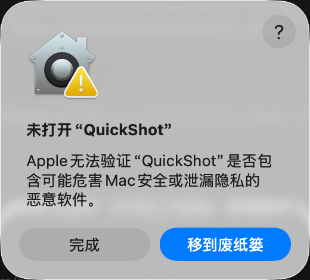
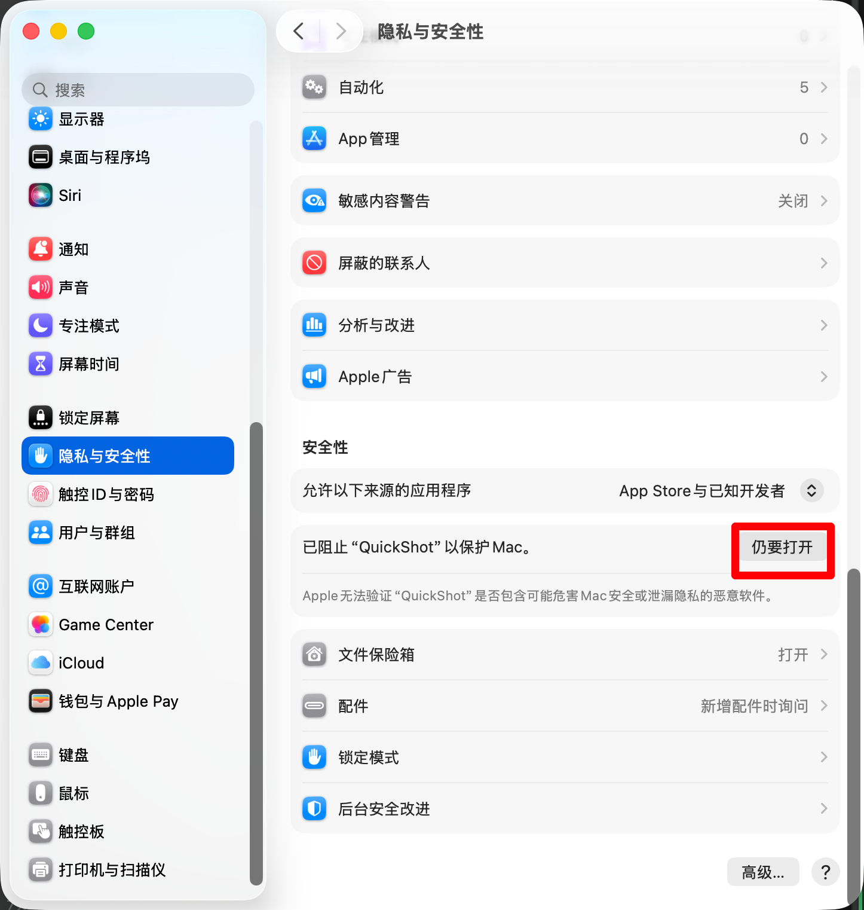
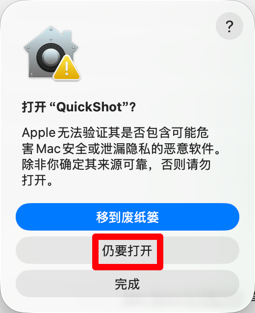
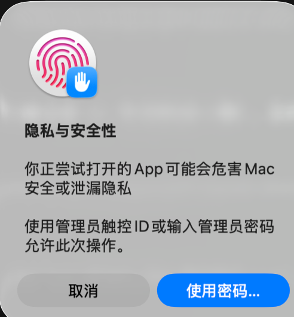
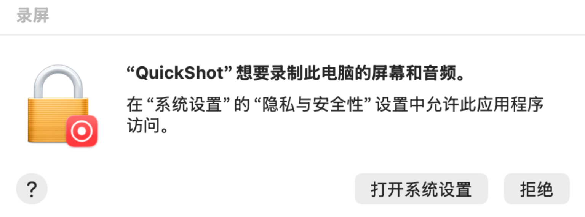
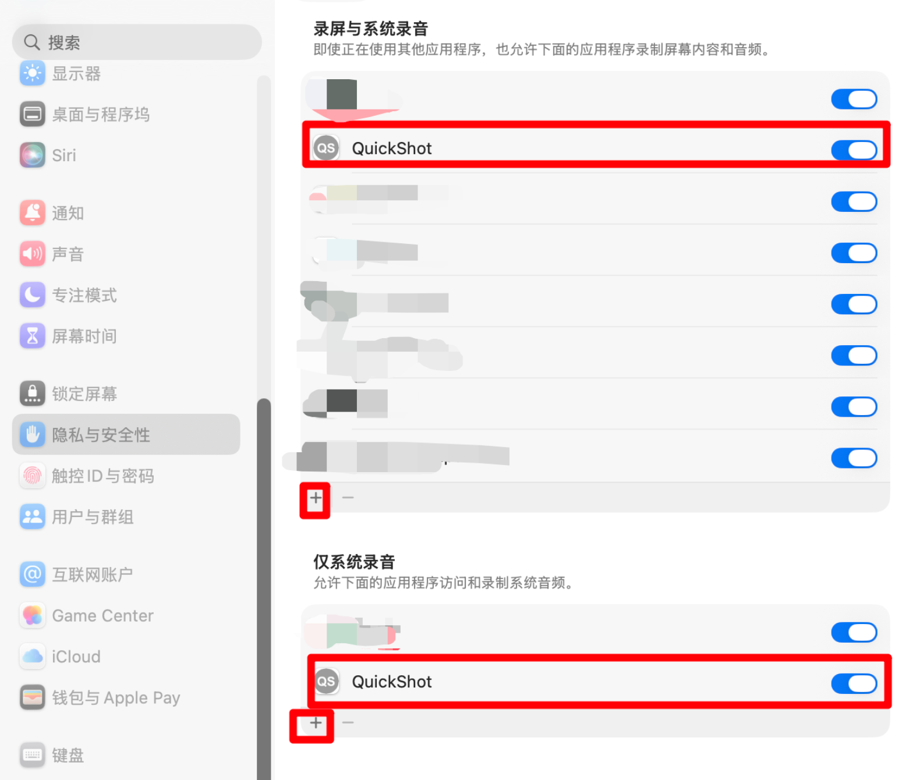

# QuickShot 截图工具

QuickShot 是一款轻量级、功能强大的屏幕截图与录制工具，基于 **Qt 6** 开发，支持 **Windows** 与 **macOS** 双平台（Linux 支持尚不完整，录屏暂不产出视频文件），旨在提供高效、流畅的截图体验。

当前版本 **v0.1.5**，可从 [GitHub Releases](https://github.com/ChiangyangNPU/quick-shot/releases) 下载最新版本。

  

## 📚 目录

* [macOS 首次打开：未公证应用放行](#macos-first-open)
* [macOS 首次启动：录屏与系统录音授权](#macos-permissions)
* [核心功能](#features)
* [安装与部署](#installation)
* [技术特性](#technical)
* [开发环境](#dev-env)
* [更多文档](#docs)
* [许可证](#license)
* [第三方资源声明](#third-party)

<a id="macos-first-open"></a>

## ⚠️ macOS 首次打开：未公证应用需手动放行

QuickShot 目前**未做 Apple 公证**，从网页（浏览器）下载的 DMG 安装后，首次双击打开会被 macOS 拦下，提示「Apple 无法验证"QuickShot"是否包含可能危害 Mac 安全或泄漏隐私的恶意软件」。按下面 4 步放行一次即可，之后都能正常打开：



1. 在弹窗里点「**完成**」——**不要**点「移到废纸篓」，那会把应用删掉。
2. 打开「**系统设置 → 隐私与安全性**」，在「**安全性**」一栏找到「已阻止"QuickShot"以保护 Mac」，点右侧的「**仍要打开**」：



3. 在确认弹窗里再点一次「**仍要打开**」：



4. 按提示用**触控 ID** 验证，或点「**使用密码…**」输入管理员密码，允许此次操作：



系统会记住这次选择，之后双击即可正常打开。

> 部分 macOS 版本上，在 Finder 里**右键（或 Control + 点击）QuickShot.app →「打开」**也会进入上面的确认流程；若没有反应，按上面的系统设置路径操作。
> 想彻底消除该提示，需要 Apple Developer 证书并对应用做公证（本项目暂未配置）。
> 本地自行打包（`deploy/mac/deploy_mac.sh`）的 DMG 不带浏览器下载标记（quarantine），不会被 Gatekeeper 拦截。

<a id="macos-permissions"></a>

## ⚠️ macOS 首次启动：录屏与系统录音授权

> **建议先授权、再截屏/录屏。** 首次启动时请先完成下面的授权步骤，再触发截图或录屏。若先触发截屏/录屏，系统虽会弹出授权弹窗，但之后即使完成授权也可能不生效，需要退出并重新打开 QuickShot。

首次打开 QuickShot 进行**截图或录屏**时，macOS 会弹出 **""QuickShot"想要录制此电脑的屏幕和音频"** 系统弹窗——这是系统对屏幕内容访问的安全要求，允许后截图、录屏、OCR 等功能才可正常使用：



1. 在弹窗中点击「**打开系统设置**」（也可手动前往：系统设置 → 隐私与安全性）。
2. 在「**录屏与系统录音**」列表中：若 QuickShot 已在列表中，打开其开关即可；若没有，点击列表左下角 **＋** 按钮，选择 QuickShot.app 添加，并打开开关。
3. 在下方「**仅系统录音**」列表中，同样确认 QuickShot 的开关已打开（录制系统声音需要，没有也按 ＋ 添加）。



4. 若需录制**麦克风**声音，另在「隐私与安全性」→「**麦克风**」中勾选 QuickShot。
5. 授权后**退出并重新打开 QuickShot** 才会生效。

<a id="features"></a>

## ✨ 核心功能

### 1. 智能截图

* **全局快捷键**: 默认 `Alt + Q` 截图、`Alt + S` 录屏、`Alt + H` 历史记录、`Alt + P` 贴图剪贴板、`Alt + Shift + F` 全屏截图、`Alt + Shift + W` 活动窗口截图、`Alt + Shift + S` 录屏暂停/恢复、`Alt + Shift + Q` 录屏停止、`Alt + Shift + P` 隐藏/显示所有贴图，均可在设置中修改。
* **智能窗口吸附**: 鼠标悬停在软件窗口上时，自动识别并高亮窗口区域，点击即可快速选取。
* **显示器/全屏切换**: 支持矩形区域、窗口、显示器、桌面四种截图范围，鼠标滚轮可快速切换吸附层级。
* **自由矩形选区**: 支持鼠标拖拽，创建任意大小的矩形截图区域。
* **长截图（滚动截图）**: 选区完成后按 `V` 垂直或 `H` 水平开始，也可点击工具栏「长截图」按钮；滚动页面自动拼接，`Enter` 完成、`Esc` 取消。截图期间选区边框保持可见且不会被拍进长图，提示条可一键切换垂直/水平方向；自动排除固定页脚，结果以贴图窗口展示，可继续复制/保存/标注/翻译。
* **智能右键交互**: 未选区时自动吸附鼠标下的窗口（在桌面背景则全屏）；已选区时取消当前截图；绘图时取消当前绘制，防止误触。

### 2. 强大的标注工具

截图选定后，底部工具栏提供丰富的编辑功能，支持**二级菜单**自定义：

* **🔲 图形工具**: 矩形、椭圆、三角形、直线、箭头；12 色预设面板（`Tab` 键循环切换）；各图形工具均支持实线/虚线切换，线型偏好按工具独立记忆，重启后保持。
* **✏️ 画笔工具**: 自由书写和绘制线条，支持粗细调节与颜色选择。
* **📝 文本工具**: 在截图任意位置输入文字，支持实时字号调整、颜色更换与拖动定位。
* **▒ ▓ 马赛克工具**: 对敏感信息（如账号、密码）进行像素化模糊处理。
* **🧹 橡皮擦工具**: 点选或划过标注即可将其删除。
* **🖱️ 拖动移动**: 鼠标悬停在最近一个标注上（马赛克/橡皮擦除外）即可整体拖动标注，移动范围限制在选区内，支持撤销/重做。
* **撤销/重做**: `Ctrl+Z` 撤销、`Ctrl+Y` 重做，撤销时优先撤销移动操作，再撤销标注创建。
* **📐 标注约束**: 绘制矩形/椭圆/箭头/直线时按住 `Shift` 等比约束，按住 `Alt` 以起点为中心对称绘制，可组合使用，约束范围自动限制在选区内。

### 3. 灵活的区域调整

* **选区微调**: 截图区域的 8 个边缘和角点均可拖动，精细调整截图范围。
* **整体移动**: 鼠标按住选区内部，可自由拖动整个截图选区的位置。
* **锁定标注模式**: 选择标注工具后选区锁定，专注于绘制标注。

### 4. 📝 OCR 文字识别

* **一键识别**: 点击工具栏「文字识别」按钮，即可对截图区域进行文字识别。
* **多语言支持**: 支持中英文、英文、日文、韩文和多语言混合文本。
* **GPU 加速**: 可在设置中启用 GPU 加速，提升识别速度。
* **结果展示**: 识别结果以弹窗展示，支持一键复制全部文本，可拖动移动窗口、拖动边缘/角落调整大小。
* **多入口支持**: 录屏模式与贴图窗口右键菜单同样支持文字识别。
* **后台执行**: 识别在后台线程异步进行，不阻塞界面。

### 5. 🌐 文字翻译

QuickShot 提供两种翻译形式，基于 OCR 识别结果将文字翻译为目标语言，支持 4 种翻译引擎。

**形式一：OCR 结果弹窗内对照翻译** —— 在识别结果弹窗底部点击「翻译」，可切换原文 / 译文 / 对照三态视图；采用整段翻译，请求次数少、额度消耗低。

**形式二：翻译结果窗口（左图右文分栏）**

* **四处入口**: 截图工具栏、录屏工具栏、贴图窗口右键菜单、晾衣绳卡片悬停预览右键菜单。
* **分栏窗口**: 左侧为等比缩放的截图原图，拖动中间分栏线可调整两栏宽度；右侧为可选中、可滚动的译文区，支持仅原文 / 仅译文 / 对照三态切换（默认译文）。
* **窗口操作**: 标题栏拖动、双击关闭、右下角抓手缩放、`Esc` 关闭，跟随应用浅色/深色主题。
* **复制与保存**: 底部操作栏提供「复制全文」「另存为图片」，右键菜单提供视图切换、复制原文、复制译文、另存为图片、关闭。
* **批量翻译**: 按 OCR 识别段逐段翻译，单段失败回退原文，不中断整体流程。

| 引擎           | 类型                 | 说明                                                          |
| -------------- | -------------------- | ------------------------------------------------------------- |
| MyMemory       | 默认，免注册         | 国内可直连，无 email 5000 词/天，填 email 提升至 50000 词/天   |
| 百度翻译       | 用户自填 AppId + Key | 国内稳定，每月免费 200 万字符                                  |
| DeepL          | 用户自填 Key         | 翻译质量最高                                                   |
| LibreTranslate | 用户自填 URL         | 可自托管实现完全离线                                           |

> **隐私保护**：首次使用翻译时弹窗说明文本将发送到第三方服务，可勾选「不再提示」。所有 Key / URL 由用户在设置页填写，软件不预置任何凭证，API Key 加密存储（Windows DPAPI / macOS Keychain）。详见 [翻译功能技术文档](docs/translation-design.md)。

### 6. 📌 贴图 (Pin) 功能

* **悬浮置顶**: 点击工具栏「Pin」按钮，将当前截图（含标注）贴在桌面上，默认置顶；拖动可移动，拖动边缘可缩放（高分屏画质无损），双击关闭。
* **滚轮缩放**: 贴图窗口支持滚轮缩放，标注与马赛克笔迹同步缩放。
* **右键菜单**: 复制 → 标注 → OCR → 翻译 → 保存（关闭请双击或按 `Esc`）。
* **标注模式**: 右键菜单进入标注模式，支持矩形/椭圆/箭头/画笔/直线/文本/马赛克/橡皮擦 8 种工具（数字键 1-8 切换）、Shift/Alt 约束、撤销/重做。
* **快捷键**: `Ctrl+C` 复制、`Ctrl+S` 保存、`Ctrl+Z`/`Ctrl+Y` 撤销/重做（`Ctrl+Shift+Z` 为重做别名）、方向键移动窗口（`Ctrl+方向键` 快速移动 10px）、`Delete`/`Backspace` 清除所有标注、`F5` 重新抓屏、`Esc` 退出标注模式或关闭窗口。
* **Alt+P 贴图剪贴板历史分页**: 首次按下在鼠标所在屏幕中心显示最新截图，之后每次按下按时间倒序循环显示更早的截图（窗口依次偏移 (24,24) 并夹到屏幕边界），到最旧后回到最新。
* **一键隐藏贴图**: `Alt + Shift + P` 隐藏/显示所有贴图窗口。

### 7. 📹 屏幕录制

* **全局快捷键**: 默认 `Alt + S` 开始录屏（可在设置中修改）。
* **区域/窗口录制**: 支持选择任意矩形区域或直接录制指定窗口。
* **音频录制**: 系统声音与麦克风声音可独立开关，支持同时录制。
* **录制控制**: 支持开始、暂停、恢复、停止；取消录制时自动删除已生成的视频文件。
* **实时标注**: 录制过程中可使用全部标注工具（箭头/矩形/椭圆/三角形/直线/画笔/文本/马赛克/橡皮擦），标注不会与画面重复叠加，拖拽过程也完整录进视频。
* **录制格式**: 控制栏提供 MP4 / GIF 下拉选择并全局记忆；选 GIF 时自动取消并禁用音频选项。
* **GIF 录制**: 截图与录屏工具栏均提供 GIF 快捷入口（默认 10 fps、无音轨），内置纯 Qt 编码器，Windows / Linux 可用，macOS 暂不支持（入口自动隐藏）。
* **快照**: 录制中可将当前画面截图到剪贴板，不中断录制，并自动记录到历史供 `Alt+P` 使用。
* **原始分辨率**: 输出分辨率等于框选区域的物理像素大小，无缩放损失。
* **其他**: 可自定义保存目录，录制过程中实时显示录制时长。
* **macOS 支持**: 基于 ScreenCaptureKit，要求 macOS 13+（Ventura），支持 Retina 屏高清录制。

### 8. 📋 历史记录

* **全局快捷键**: 默认 `Alt + H` 打开历史记录窗口（可在设置中修改）。
* **截图历史**: 自动记录所有截图（包括保存和复制到剪贴板的截图），生成缩略图便于浏览。
* **剪贴板历史**: 自动记录复制/剪切的文本内容，包含来源应用信息。
* **分类与搜索**: 支持按「全部 / 截图 / 文本」分类查看，支持关键词搜索。
* **多选与批量操作**: 支持拖拽框选、`Ctrl+点击` 追加、`Shift+点击` 范围选中，可批量删除；按钮状态随选中数量和类型联动。
* **操作功能**: 复制文本/截图到剪贴板、保存截图到文件、删除单条/批量记录、清空所有历史，右键菜单提供快捷操作。
* **自动清理**: 启动时自动清理过期记录（默认保留 7 天）和超额记录（默认最大 1000 条），也可手动触发。
* **实时刷新**: 历史窗口打开时，新增记录自动刷新显示。
* **本地存储**: 所有历史记录仅存储在本地 SQLite 数据库，不上传任何服务器。

### 9. ⚙️ 设置中心

右键系统托盘图标进入「设置」，共 7 个选项卡：**常规 → 快捷键 → 样式 → 翻译 → 历史记录 → 宠物 → 关于**。

* **常规**: 界面语言（简体中文 / English / 日本語 / 한국어 / 繁體中文（香港/台灣））、开机自启动、截图与录屏保存目录、日志与配置文件管理、OCR 识别语言、GPU 加速。
* **快捷键**: 9 个全局热键可自定义，标注工具、标注操作、贴图快捷键按分类展示，修改即时生效。
* **样式**: 浅色/深色主题一键切换（深色为 HUD 风格，整个应用界面统一生效）；支持自定义 20+ 项界面颜色、按钮显示模式（文字/图标）、子工具栏与控制栏配色。
* **翻译**: 选择翻译引擎、目标语言（默认英文）、填写对应引擎的 API Key / URL、启用翻译功能与首次隐私提示。
* **历史记录**: 开关截图/剪贴板历史、设置保留天数（7/30/90/180/365 天）与最大条数（500/1000/2000/5000）、清理过期记录、清空历史、查看存储占用。
* **宠物**: 桌面宠物开关、内置与自定义外观、装饰、晾衣绳触发方式、待办提醒、番茄钟与打盹时长、系统状态监控、节日彩蛋与生日、重置宠物位置。
* **关于**: 版本信息及 GitHub 仓库链接。

### 10. 🐾 桌面宠物

* **外观**: 16 种代码绘制造型（经典：猫/熊猫/企鹅/青蛙；十二生肖 12 种）+ 2 种图片型特殊样式（鲸鱼娘 / 鲸鱼娘 2），可配戴 7 种装饰；也支持导入本地 PNG/JPG/WebP/GIF 作为自定义外观。所有设置持久化，重启自动恢复。
* **交互**: 常驻桌面的透明置顶窗口，可拖动；待机随机眨眼，投喂时张嘴等待、咀嚼弹跳，双击摸头弹跳，长时间无互动自动打盹，任意互动即唤醒。
* **投喂动画**: 截图复制/贴图/快照后，截图从原位置飞入宠物嘴中；复制文本时以卡片形式从鼠标位置飞入。
* **待办与番茄钟**: 右击宠物展开待办清单（本地持久化），未完成/逾期待办在头顶显示红点角标；开启番茄钟后按工作/休息节奏弹出提醒卡。
* **系统状态**: 可监控 CPU/内存占用与电池电量，异常时宠物给出提示。
* **节日彩蛋**: 圣诞/万圣节/元旦等节日自动戴上应景帽子，可设置生日并在当天庆生。
* **晾衣绳（历史快捷面板）**: 铺满主屏宽度，悬挂最近 12 条历史记录卡片，带摆动与出入场动画并实时刷新。悬停放大预览（图片支持 0.2–10 倍滚轮缩放），单击复制内容，右键可复制 / 标注 / 文字识别 / 翻译；触发与关闭方式可在设置中调整（单击宠物 / 主屏顶边热区 / 两者皆可）。

<a id="installation"></a>

## 📦 安装与部署

### 开发者构建

1. 确保已安装 Qt 6.10.2（开发环境版本，建议不低于 6.10）和 CMake ≥ 3.20。
2. 克隆项目并编译：

   ```bash
   mkdir build && cd build
   cmake ..
   cmake --build .
   ```

**构建选项与依赖**：

* **ONNX Runtime**: OCR 推理库（1.26.0）。Windows 构建时若未检测到，CMake 会自动下载并解压到 `third_party/onnxruntime`；也可通过 `ONNXRUNTIME_ROOT` 环境变量（或同名 CMake 变量）指定已安装路径，或直接预置到 `third_party/onnxruntime`。
* `ENABLE_OCR_GPU_ACCELERATION`: 是否编译 OCR GPU 加速支持（CoreML/DirectML），默认 `ON`。
* `QUICKSHOT_BUILD_TESTS`: 是否构建单元测试，默认 `ON`。

**运行测试**：`tests/` 目录下包含 14 个 Qt Test 单元测试，以默认的 `QUICKSHOT_BUILD_TESTS=ON` 构建后，在 build 目录运行 `ctest` 即可执行全部测试。

**版本号管理**：版本号由 [CMakeLists.txt](CMakeLists.txt) 的 `project(QuickShot VERSION x.y.z)` 统一管理，通过 `QUICKSHOT_VERSION` 宏注入源码。修改版本号后需在 CLion 中 **Reset Cache and Reload CMake Project**。

> **Windows 环境搭建与路径配置**（Qt / MinGW / CMake / ONNX Runtime 的路径指定、CLion 工具链、常见问题）详见 [Windows 构建指南](docs/build-windows.md)。

### 快速打包

项目提供了自动化打包脚本，无需手动复制 DLL，脚本会自动从 CMakeLists.txt 读取版本号。

**Windows**：在 `deploy/win/` 目录运行 PowerShell 脚本。

```powershell
.\deploy.ps1      # 同时打包 Debug 和 Release（默认）
.\deploy.ps1 -r   # 仅打包 Release
.\deploy.ps1 -d   # 仅打包 Debug
```

脚本会在 `deploy/win/` 下生成 `QuickShot-Release-v{version}-Windows-x64` 文件夹（含可直接运行的 `QuickShot.exe` 及全部依赖）和对应 zip 包。

**macOS**：进入 `deploy/mac/` 目录运行 Shell 脚本。

```bash
./deploy_mac.sh                        # 同时构建 Debug 和 Release（默认）
./deploy_mac.sh -r                     # 仅构建 Release
./deploy_mac.sh -d                     # 仅构建 Debug
./deploy_mac.sh -r --no-gpu-acceleration  # 禁用 CoreML，仅 CPU 推理
```

脚本会在 `deploy/mac/` 下生成 `QuickShot-Release-v{version}.dmg`（含 Qt 依赖、ONNX Runtime、语言文件，已自动签名）。详见 [Mac 打包指南](deploy/mac/README_DEPLOY_MAC.md)。

<a id="technical"></a>

## 🛠️ 技术特性

* **跨平台**: Windows 使用 Media Foundation + WASAPI，macOS 使用 ScreenCaptureKit + AVAssetWriter 录屏；Linux 目前仅实现 X11 帧采集与 GIF 编码。
* **高分屏与多显示器**: 手动 DPI 适配（`pt`/`em` 单位，DPI 变化时重载全局样式），截图与贴图保持 1:1 像素级清晰；Windows/Linux 使用虚拟桌面全局坐标支持跨屏截取与录制，macOS 兼容 Sidecar/AirPlay。
* **国际化**: 内置简体中文、English、繁體中文（香港/台灣）、日本語、한국어 6 种语言，运行时可动态切换。
* **OCR 与翻译**: ONNX Runtime + PP-OCRv4 模型，支持 GPU 加速；翻译提供 MyMemory / 百度 / DeepL / LibreTranslate 四种引擎。
* **性能**: OCR 模型与翻译引擎延迟初始化，截屏与文字识别在后台线程执行，录屏复用帧缓冲减少内存分配。
* **自动更新**: 按地区优先 Gitee / GitHub / 官网多渠道回退检查，SHA256 校验下载包，更新失败可回滚。
* **配置与日志**: QSettings 统一持久化配置，日志按级别写入安装目录下 `logs/`。

<a id="dev-env"></a>

## 🚀 开发环境

* **语言**: C++ 17
* **框架**: Qt 6.10.2
* **构建系统**: CMake
* **编译器**: MinGW 64-bit (Windows) / Clang (macOS)
* **OCR**: ONNX Runtime

<a id="docs"></a>

## 📚 更多文档

* [架构说明](docs/architecture.md)：模块划分、整体设计与关键设计决策。
* [标注系统](docs/annotation.md)：标注工具、交互、快捷键与扩展指南。
* [OCR 功能](docs/ocr.md)：OCR 引擎实现与配置。
* [历史记录功能](docs/history-feature.md)：历史记录与晾衣绳快捷面板设计。
* [桌面宠物陪伴功能](docs/pet-companion-plan.md)：待办/番茄钟/打盹/系统状态/装饰彩蛋方案。
* [翻译功能](docs/translation-design.md)：翻译引擎抽象与批量翻译流程。
* [快捷键说明](docs/shortcuts.md)：全局热键与标注/贴图快捷键一览。
* [Windows 录屏](docs/recording-windows.md)：Windows 录屏实现细节。
* [macOS 录屏](docs/recording-macos.md)：macOS ScreenCaptureKit 录屏实现。
* [Windows 构建指南](docs/build-windows.md)：Windows 环境搭建与常见问题。
* [发布流程](docs/release-publish.md)：GitHub / Gitee 双端版本发布步骤。
* [多远程仓库同步](docs/git-multi-remote.md)：GitHub / Gitee 双远程管理。

<a id="license"></a>

## 📄 许可证

本项目采用**双许可（Dual Licensing）**模式：

### 开源使用：GPLv3

本项目以 **GNU General Public License v3.0** 发布，著作权归原作者 **chiangyang** 所有。您可以自由使用、修改和分发，前提是遵守 GPLv3：

* ✅ 个人使用、学习、研究，以及企业内部使用
* ✅ 修改并分发（须同样以 GPLv3 公开完整对应源码）
* ❌ 将本项目或其衍生作品闭源分发

### 商业授权

如需在闭源产品中集成、二次开发后闭源分发，或希望免除 GPLv3 的源码公开义务，请联系作者获取商业授权，详见 [商业授权说明](COMMERCIAL-LICENSE.md)。

> 说明：GPLv3 与本项目依赖兼容（Qt 6 开源版 LGPLv3、ONNX Runtime MIT、PaddleOCR Apache-2.0）。

完整条款请参见 [LICENSE](LICENSE) 文件。

<a id="third-party"></a>

## 📦 第三方资源声明

本项目使用了以下开源资源：

### OCR 算法与模型

* **OCR 核心算法**: 移植自 [PaddleOCR](https://github.com/PaddlePaddle/PaddleOCR) 开源项目
  * 实现内容: DB 检测后处理、图像预处理、CTC 识别解码
  * 许可证: [Apache License 2.0](https://www.apache.org/licenses/LICENSE-2.0)
  * 使用方式: 算法逻辑移植为纯 C++/Qt 实现，不依赖 OpenCV
* **PP-OCRv4 模型**: 基于 PaddleOCR 开源项目的预训练模型
  * 许可证: [Apache License 2.0](https://www.apache.org/licenses/LICENSE-2.0)
  * 使用方式: 使用预训练的 ONNX 模型权重文件

### 推理引擎

* **ONNX Runtime**: 微软开源的机器学习模型推理引擎
  * 许可证: [MIT License](https://opensource.org/licenses/MIT)
  * 项目地址: <https://github.com/microsoft/onnxruntime>

### Qt 框架

* **Qt 6**: 跨平台 C++ 应用开发框架
  * 许可证: LGPL 3.0 / GPL 3.0 (开源版)
  * 项目地址: <https://www.qt.io/>

感谢以上开源项目的贡献！
