# QuickShot 翻译功能技术文档

## 1. 概述

QuickShot 的翻译功能基于截图 OCR 识别结果，将识别出的文字翻译为目标语言。
提供两种使用形式：

| 形式 | 说明 | 使用场景 |
|---|---|---|
| OCR 结果弹窗翻译 | 在 OCR 识别结果弹窗底部点击「翻译」，弹窗内切换原文/译文/对照 | 查看 OCR 结果时顺带翻译 |
| 翻译结果窗口（左图右文分栏） | 在截图工具栏 / 录屏工具栏 / 钉图窗口右键点击「翻译」，弹出独立窗口：左侧显示原图、右侧显示可选中可滚动的译文 | 对比阅读，译文可自由选择复制 |

### 1.1 技术栈

| 组件 | 技术 | 说明 |
|------|------|------|
| 翻译引擎抽象 | 纯 Qt QObject 子类 | 统一异步 translate() 接口与错误码体系 |
| 默认引擎 | MyMemory 免费 API（免注册） | 国内可直连，带 email 提升额度至 50000 词/天 |
| 扩展引擎 | 百度翻译 / DeepL / LibreTranslate | 用户自填 Key / URL，软件不预置任何凭证 |
| 凭据存储 | SecretStore（Windows DPAPI / macOS Keychain / Linux 明文降级） | API Key 不再明文进 INI，老配置读路径自动迁移 |
| 网络请求 | Qt6::Network QNetworkAccessManager | HTTP GET/POST 视引擎而定（MyMemory/百度 GET，DeepL POST 表单编码，LibreTranslate POST JSON），响应均 JSON 解析 |
| TLS 支持 | Qt TLS 后端插件 post-build 部署 | 确保 HTTPS 请求正常 |
| 批量翻译 | 逐段顺序 + 失败回退原文 | 避免单段失败中断整体流程 |
| 国际化 | 项目 TranslationManager JSON 翻译键 | 6 种语言：zh_CN/en_US/ja_JP/ko_KR/zh_TW/zh_HK |

### 1.2 核心特性

- **默认开箱即用**：MyMemory 引擎免注册，首次使用弹出隐私提示
- **多引擎可切换**：设置页提供百度/DeepL/LibreTranslate 自填 Key 入口
- **弹窗内三态对照**：OcrResultDialog 内切换原文/译文/对照
- **左图右文分栏结果窗口**：TranslateOverlayWindow 左侧等比显示原图、右侧文本区可自由选中并滚动，视图模式仅切换右侧内容
- **窗口操作齐全**：标题栏拖动/双击关闭、右下角缩放抓手、ESC 关闭、复制全文/另存为图片、右键菜单复制原文/译文
- **错误码本地化**：9 种错误分类 → 查翻译键显示，「详细信息」保留原始报错
- **公共方法复用**：TranslateService 统一前置检查 + 错误消息；TranslateOverlayWindow::translateAndShow 封装批量翻译全流程

---

## 2. 整体架构

### 2.1 架构流程图

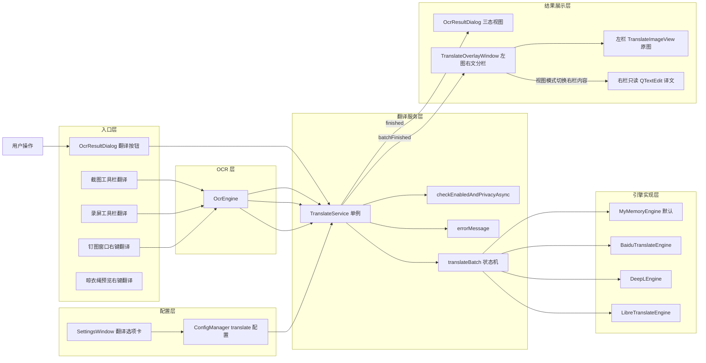

### 2.2 分层说明

- **入口层**：覆盖所有触发点
- **翻译服务层**：`TranslateService` 单例，统一管理引擎实例、配置加载、批量翻译状态机、公共静态方法
- **引擎实现层**：抽象 `TranslateEngine` 接口 + 4 种具体实现
- **结果展示层**：`OcrResultDialog`（三态视图）与 `TranslateOverlayWindow`（左图右文分栏结果窗口）
- **配置层**：`ConfigManager` 管理配置；`SettingsWindow` 提供 UI

---

## 3. 核心类图

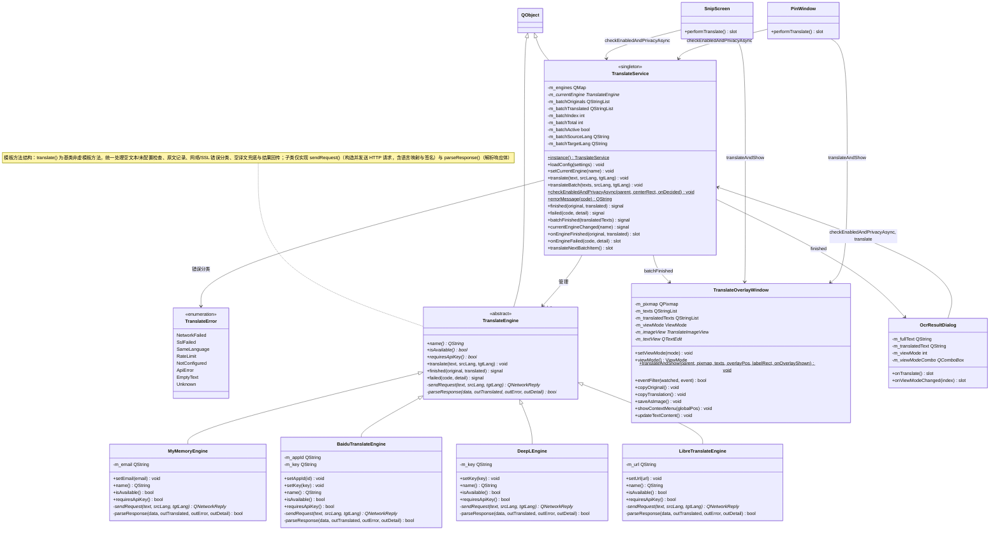

---

## 4. 翻译引擎层设计

### 4.1 抽象接口 TranslateEngine

文件：[TranslateEngine.h](../src/translate/TranslateEngine.h)

错误码枚举：

```cpp
enum class TranslateError {
    NetworkFailed,   ///< 网络错误（DNS/超时/断开）
    SslFailed,       ///< SSL/TLS 未配置或握手失败
    SameLanguage,    ///< 源语言与目标语言相同
    RateLimit,       ///< 翻译额度用尽
    NotConfigured,   ///< 引擎未配置（缺 Key/URL）
    ApiError,        ///< 引擎业务错误（非 200）
    EmptyText,       ///< 空文本
    Busy,            ///< 翻译服务忙（批量翻译进行中，暂不接受新请求）
    Unknown          ///< 未知错误兜底
};
```

### 4.2 四种引擎对比

| 引擎 | 类型 | 配置项 | 国内可达 | 额度 | 说明 |
|---|---|---|---|---|---|
| MyMemoryEngine | 默认，免注册 | 可选 email | ✅ 直连 | 无 email:5000 词/天<br>有 email:50000 词/天 | 签名不加密，最容易使用 |
| BaiduTranslateEngine | Key-Based | appId + key | ✅ 国内服务 | 每月免费 200 万字符 | 签名：`MD5(appId+query+salt+key)` |
| DeepLEngine | Key-Based | key | ❌ 需联网 | 使用免费版端点 api-free.deepl.com（付费版另有 api.deepl.com，本软件用免费版） | 翻译质量最高 |
| LibreTranslateEngine | URL-Based | 服务地址 | ✅ 自托管可达 | 取决于自托管服务 | 完全离线可实现 |

Key / URL 由用户在设置页填写，**软件不预置任何凭证**。其中百度 AppId/Key、DeepL Key 经 **SecretStore** 加密存储（Windows DPAPI 密文 Base64 回写 INI `secure/` 前缀键、macOS Keychain、Linux 明文降级），旧明文配置在读取时自动迁移（TranslateService.cpp:165-167、SecretStore.h）；LibreTranslate URL、MyMemory email 等非敏感项仍存 QSettings。

---

## 5. 配置项设计

统一前缀 `translate/`，通过 `ConfigManager::getSettings()` 读写。

| 配置键 | 类型 | 默认值 | 说明 |
|---|---|---|---|
| `translate/enabled` | bool | true | 未启用时所有翻译入口不响应 |
| `translate/engine` | QString | "mymemory" | 当前引擎 |
| `translate/targetLang` | QString | "en" | 目标语言 |
| `translate/sourceLang` | QString | "auto" | 源语言（仅内部默认值，无 UI：设置页无源语言下拉，见 ConfigManager.cpp:172） |
| `translate/mymemoryEmail` | QString | "" | MyMemory 邮箱（提升额度） |
| `translate/baiduAppId` | QString | "" | 百度 App ID（经 SecretStore 加密存储，旧明文自动迁移） |
| `translate/baiduKey` | QString | "" | 百度 Key（经 SecretStore 加密存储，旧明文自动迁移） |
| `translate/deeplKey` | QString | "" | DeepL Key（经 SecretStore 加密存储，旧明文自动迁移） |
| `translate/libreUrl` | QString | "" | LibreTranslate 地址 |
| `translate/showPrivacyWarning` | bool | true | 首次隐私提示开关 |

> 凭据存储口径：百度 AppId/Key、DeepL Key 经 SecretStore 加密存储（Windows DPAPI 密文 Base64 回写 INI `secure/` 键、macOS Keychain、Linux 明文降级），旧明文读取时自动迁移；其余项存本地 QSettings。与 1.1 技术栈表一致。

### 5.1 SettingsWindow 翻译选项卡

位置在「样式」与「历史记录」之间：**常规 / 快捷键 / 样式 / 翻译 / 历史记录 / 宠物 / 关于**。

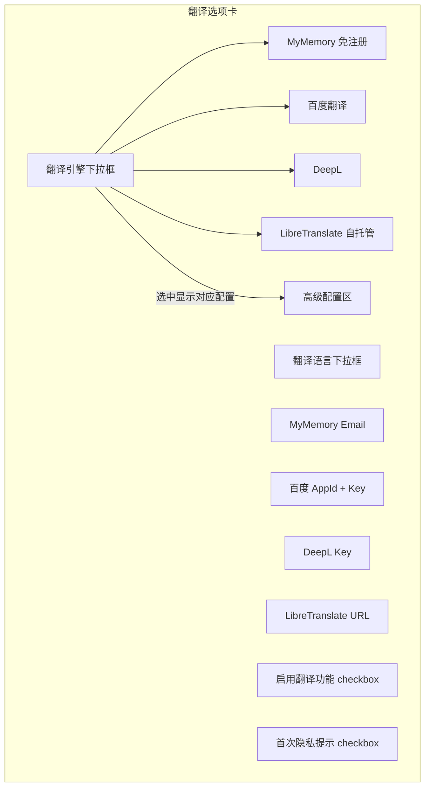

> 约定：翻译选项卡内容不多，属于「非滚动 tab」，在 `onTabChanged` 中用 `setFixedHeight` 强制高度自适应内容。

---

## 6. 形式一：OCR 结果弹窗内翻译

### 6.1 流程图

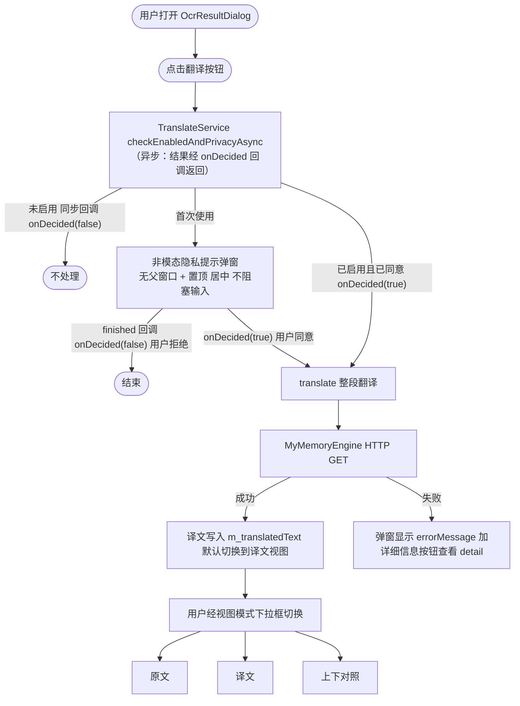

### 6.2 时序图

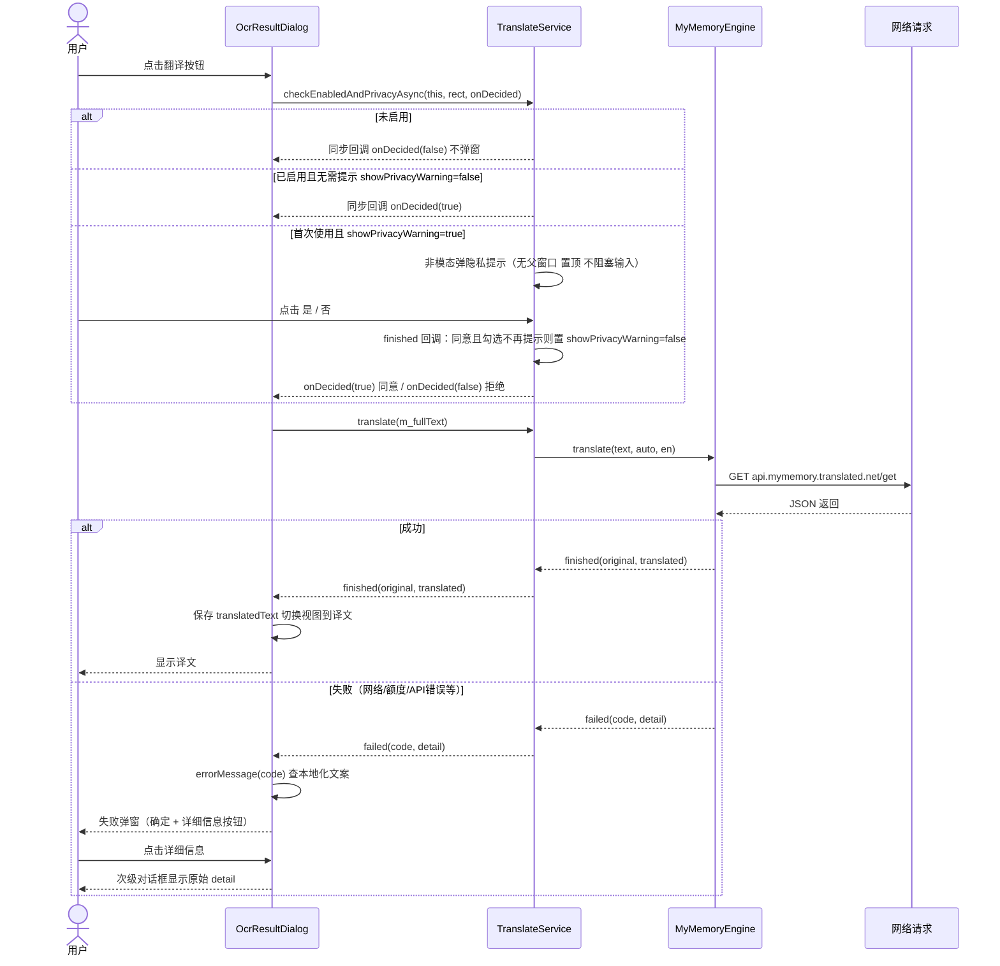

### 6.3 三态视图切换逻辑

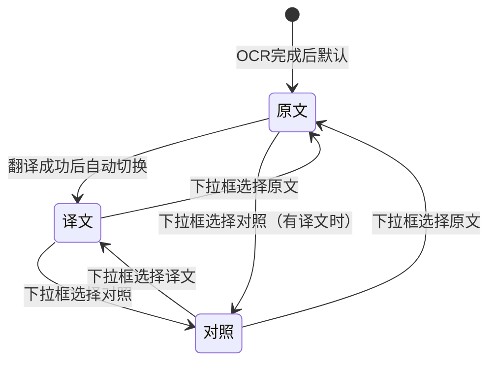

- **切换控件**：标题栏下方的视图模式下拉框 QComboBox（`m_viewModeCombo`，三态：原文/译文/对照，OcrResultDialog.cpp:99-105），切换经 `onViewModeChanged(int)` 槽处理
- **原文视图**：纯 OCR 识别文本
- **译文视图**：纯翻译后文本
- **对照视图**：按段原文 + 译文上下间隔显示（或左右对照）

### 6.4 翻译粒度

- 整段翻译：把 `m_fullText`（OCR 结果按行合并）整体送译
- 优点：请求次数少、额度消耗低、实现简单

---

## 7. 形式二：翻译结果窗口（左图右文分栏）

### 7.1 四处入口

| 入口 | 触发方式 | OCR 时机 |
|---|---|---|
| 截图工具栏 | ScreenshotToolBar 点击翻译按钮 | 截取当前选区图像 → OCR |
| 录屏工具栏 | RecordingToolBar 点击翻译按钮 | 截取当前选区图像 → OCR |
| 钉图窗口右键 | PinWindow 右键菜单「翻译」（复制→OCR→翻译→保存） | 对钉图 m_pixmap → OCR |
| 晾衣绳预览右键 | 晾衣绳卡片悬停预览（CardPreviewPopup）右键菜单「翻译」 | 图片：对预览原图 → OCR（识别后统一释放模型）；文本：跳过 OCR，直接调用 TranslateService 弹译文结果框 |

> 钉图窗口右键菜单完整顺序为：复制→标注→OCR→翻译→保存。

### 7.2 完整流程图

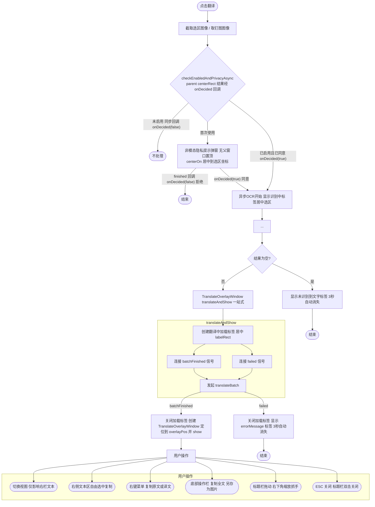

### 7.3 时序图（以 SnipScreen 截图工具栏翻译为例）

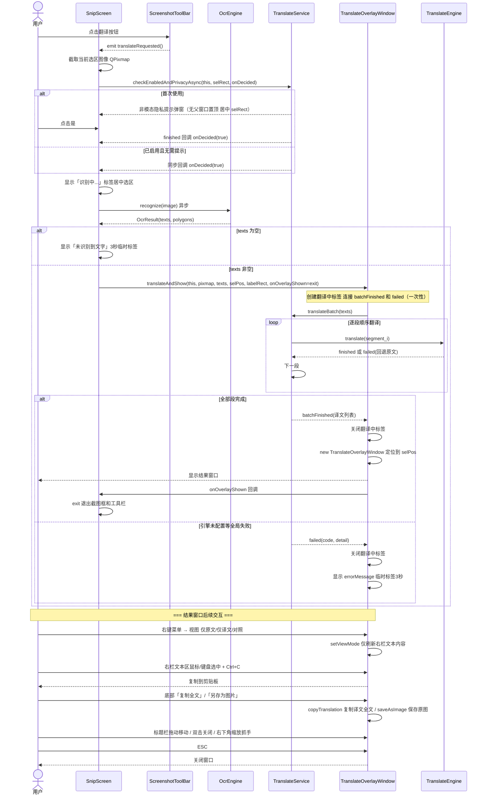

### 7.4 批量翻译状态机

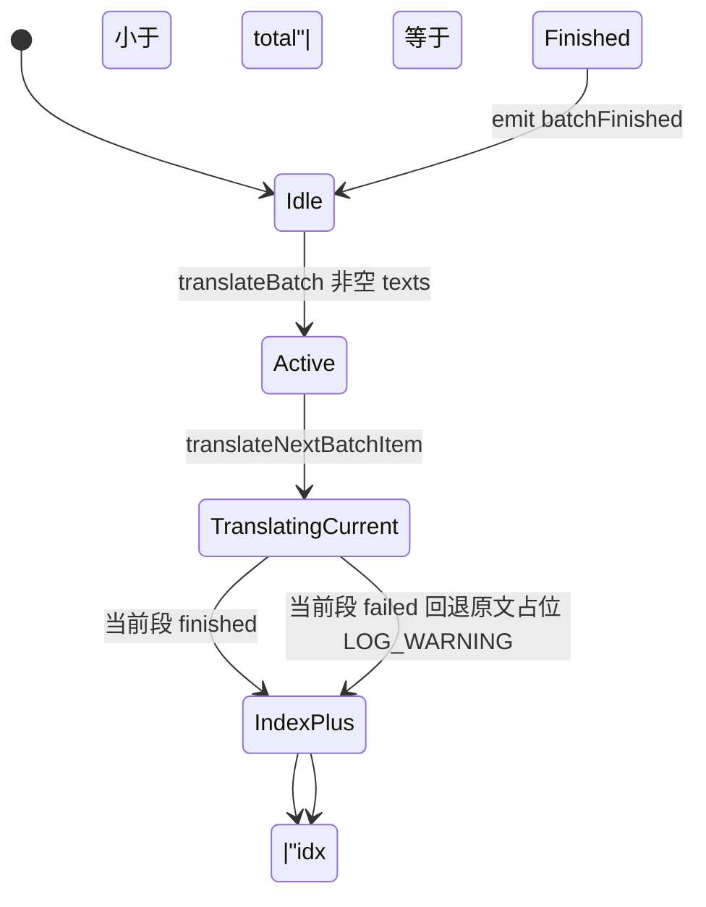

状态机成员（`TranslateService`）：
```cpp
QStringList m_batchOriginals;   // 原文列表
QStringList m_batchTranslated;  // 译文列表
int m_batchIndex = 0;           // 当前索引
int m_batchTotal = 0;           // 总段数
bool m_batchActive = false;     // 是否在批量中
QString m_batchSourceLang;      // 批量源语言（进入批量时快照，逐段复用）
QString m_batchTargetLang;      // 批量目标语言（进入批量时快照，逐段复用）
```

另有 `currentEngineChanged(name)` 信号：`setCurrentEngine()` 切换并重建当前引擎后发出（TranslateService.cpp:233）。

### 7.5 TranslateOverlayWindow 分栏布局与视图切换

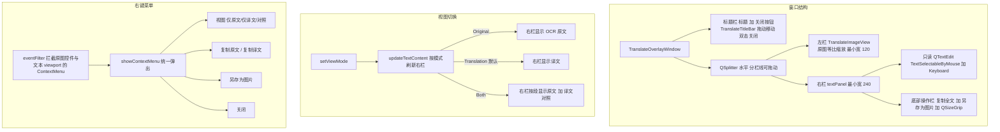

---

## 8. 隐私与错误处理

### 8.1 首次隐私提示定位策略

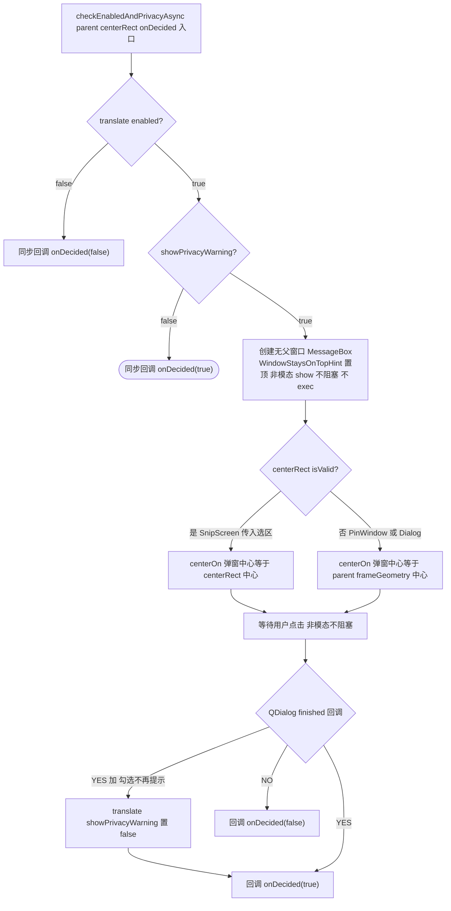

> **实现要点**（TranslateService.cpp:37-107）：
> - 全平台统一"无父窗口 + 置顶 + 非模态"消息框：不阻塞输入、不改宿主窗口标志、不触发模态禁用/恢复链路（Windows 上应用模态框在置顶透明截图覆盖层之上开合会破坏鼠标派发）。
> - 结果不经返回值，而是经 `QDialog::finished` 回调调用 `onDecided(allowed)`；未启用或无需提示时**同步**回调。
> - macOS 附加处理：Qt 把带模态性的 QMessageBox 固定在模态面板级别(8)且手动抬级别会被重置，故弹框期间用 `Utils::beginModalOverOverlay`（setLevel 直接改合成层级、不重建窗口）把宿主置顶覆盖层临时降到普通级别，弹框关闭后在回调里恢复，避免被 101 级别的截图覆盖层挡住。

### 8.2 错误码 → 本地化消息对应表

| TranslateError | 翻译键 | zh_CN 示例 |
|---|---|---|
| NetworkFailed | `translate.errNetwork` | 网络连接失败，请检查网络后重试。 |
| SslFailed | `translate.errSsl` | SSL/TLS 未正确配置，无法建立加密连接，请检查 TLS 插件部署。 |
| SameLanguage | `translate.errSameLang` | 源语言与目标语言相同，请更换目标语言。 |
| RateLimit | `translate.errRateLimit` | 翻译额度已用尽，请稍后重试或更换引擎。 |
| NotConfigured | `translate.errNotConfigured` | 翻译引擎未配置，请在设置中完成配置。 |
| ApiError | `translate.errApi` | 翻译服务返回错误。 |
| EmptyText | `translate.errEmpty` | 没有可翻译的文本。 |
| Busy | `translate.errBusy` | 正在批量翻译中，请稍后再试。 |
| Unknown | `translate.errUnknown` | 翻译失败，请稍后重试。 |

> 映射实现：`TranslateService::errorMessage()` switch-case（TranslateService.cpp:118-135），共 9 个错误分类。

失败弹窗结构：
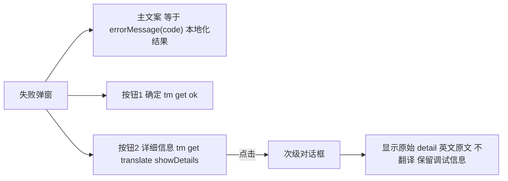

---

## 9. 公共复用方法（重构提取）

| 方法签名 | 定义位置 | 消除的重复点 |
|---|---|---|
| `TranslateService::checkEnabledAndPrivacyAsync(parent, centerRect, onDecided) → void` | TranslateService 静态 | OcrResultDialog、SnipScreen、PinWindow 3 处各自实现的启用检查 + 隐私提示弹窗（异步回调式：非模态弹窗 + finished 回调 onDecided，未启用/无需提示时同步回调） |
| `TranslateService::errorMessage(code) → QString` | TranslateService 静态 | 3 处入口各自实现的 TranslateError → 本地化 switch-case（各 8 个 case） |
| `TranslateOverlayWindow::translateAndShow(parent, pixmap, texts, overlayPos, labelRect, onOverlayShown) → void` | TranslateOverlayWindow 静态 | SnipScreen、PinWindow 两处翻译流程中的：标签创建与居中、batchFinished + failed 一次性信号连接、结果窗口创建与定位、错误临时提示标签、翻译完成后回调（SnipScreen 退出截图框） |

---

## 10. 模块划分与文件清单

### 10.1 新增文件

| 文件 | 说明 |
|---|---|
| `src/translate/TranslateEngine.h/.cpp` | 抽象接口 + TranslateError 枚举 |
| `src/translate/MyMemoryEngine.h/.cpp` | 默认引擎（免注册） |
| `src/translate/BaiduTranslateEngine.h/.cpp` | 百度翻译（用户自填 Key） |
| `src/translate/DeepLEngine.h/.cpp` | DeepL（用户自填 Key） |
| `src/translate/LibreTranslateEngine.h/.cpp` | LibreTranslate（自托管 URL） |
| `src/translate/TranslateService.h/.cpp` | 单例 + 批量状态机 + checkEnabledAndPrivacyAsync + errorMessage |
| `src/widgets/TranslateOverlayWindow.h/.cpp` | 翻译结果窗口（左图右文分栏）+ translateAndShow + onOverlayShown 回调 |
| `icons/translate.svg` | 翻译按钮图标（「文/A」设计） |

### 10.2 修改文件

| 文件 | 改动 |
|---|---|
| `src/ocr/OcrResultDialog.h/.cpp` | 翻译按钮、三态视图、失败弹窗（详细信息按钮） |
| `src/widgets/BaseToolBar.h/.cpp` | 加 translateRequested 信号 + m_translateBtn 公共成员 |
| `src/widgets/ScreenshotToolBar.cpp` | 创建翻译按钮并连接 translateRequested |
| `src/widgets/RecordingToolBar.cpp` | 创建翻译按钮并连接 translateRequested |
| `src/widgets/PinWindow.h/.cpp` | 右键加翻译项（顺序：复制→标注→OCR→翻译→保存，PinWindow.cpp:455-488） |
| `src/capture/SnipScreen.h/.cpp` | 连接两个工具栏 translateRequested、performTranslate、隐私提示居中选区 |
| `src/widgets/SettingsWindow.h/.cpp` | 翻译选项卡（样式与历史记录之间） |
| `src/core/ConfigManager.cpp` | translate/ 默认配置初始化 |
| `src/languages/*.json`（6 个） | 加 50 个 `translate.*` 翻译键（第 11 节为主要键摘录，非穷举） |
| `CMakeLists.txt` | Qt6::Network 模块 + 翻译源文件 + post-build TLS 插件部署 |
| `src/resources.qrc` | translate.svg 图标引用 |

---

## 11. 翻译键（i18n）主要清单（非穷举）

文件路径：`src/languages/{zh_CN,en_US,ja_JP,ko_KR,zh_TW,zh_HK}.json`

| 键 | 说明（zh_CN） |
|---|---|
| `tabTranslate` | 设置页「翻译」选项卡标题 |
| `ocr.translate` | OCR 弹窗「翻译」按钮文本 |
| `translate.button` | 工具栏「翻译」按钮文本 |
| `translate.translating` | 「翻译中...」加载提示 |
| `translate.viewMode` | 右键「视图模式」子菜单标题 |
| `translate.viewOriginal` | 原文视图 |
| `translate.viewTranslation` | 译文视图 |
| `translate.viewBoth` | 对照视图 |
| `translate.copyOriginal` | 复制原文 |
| `translate.copyTranslation` | 复制译文 |
| `translate.saveAsImage` | 另存为图片 |
| `translate.selectText` | 选择文字开关 |
| `translate.targetLang` | 设置页「目标语言」 |
| `translate.engine` | 设置页「翻译引擎」 |
| `translate.engineMyMemory` | MyMemory（免注册） |
| `translate.engineBaidu` | 百度翻译 |
| `translate.engineDeepL` | DeepL |
| `translate.engineLibre` | LibreTranslate（自托管） |
| `translate.privacyTitle` | 隐私提示标题 |
| `translate.privacyMsg` | 隐私提示正文 |
| `translate.privacyDontAsk` | 不再提示复选框 |
| `translate.showDetails` | 失败弹窗「详细信息」按钮 |
| `translate.errNetwork` | 网络连接失败 |
| `translate.errSsl` | SSL/TLS 错误 |
| `translate.errSameLang` | 源目标语言相同 |
| `translate.errRateLimit` | 额度用尽 |
| `translate.errNotConfigured` | 引擎未配置 |
| `translate.errApi` | 服务返回错误 |
| `translate.errEmpty` | 文本为空 |
| `translate.errBusy` | 批量翻译进行中 |
| `translate.errUnknown` | 未知错误 |

> **非穷举清单**：zh_CN.json 实际共 **50 个 `translate.*` 键**，上表为主要摘录。未列出的还有：`translate.enabled`、`translate.failed`、`translate.loading`、`translate.copy`、`translate.selectAll`、`translate.options`、`translate.privacyWarning`（均为设置页/右键菜单标签），`translate.{mymemory,baidu,deepl,libre}NetworkHint`（4 个引擎网络提示）、`translate.{mymemory,baidu,deepl,libre}WebsiteLink`（4 个引擎官网链接）、`translate.mymemoryEmailHint`，以及 4 个引擎配置键标签 `translate.baiduAppId`/`translate.baiduKey`/`translate.deeplKey`/`translate.libreUrl`。
>
> **无「源语言」UI**：设置页翻译选项卡仅提供目标语言下拉（SettingsTranslateTab.cpp:174-188），没有源语言下拉；`translate/sourceLang`（ConfigManager.cpp:172）仅为配置内部默认值（"auto"），无对应 i18n 键（早期清单中的「源语言」「自动检测」两个翻译键已删除，6 个语言文件均不存在）。

---

## 12. 风险与取舍

| 风险 | 影响 | 应对 |
|---|---|---|
| MyMemory 国内偶发不稳定 | 翻译失败 | 错误码友好提示；用户切换百度/自托管引擎 |
| MyMemory 额度耗尽 | 高频用户超额 | 设置引导填 email 提升额度；超额提示切换引擎 |
| 在线翻译隐私泄露 | 敏感文本外泄 | 首次隐私提示 + LibreTranslate 自托管引导 |
| 批量翻译请求多 | 慢速 + 高额度消耗 | 逐段顺序 + 失败回退原文；未来可优化短文本合并 |
| 译文长度与原文差异大 | 右栏内容过长 | 右栏可滚动查看；对照模式逐段对应兜底 |
| 网络 API 变更 | 引擎失效 | 抽象接口隔离，单引擎失效不影响整体 |
